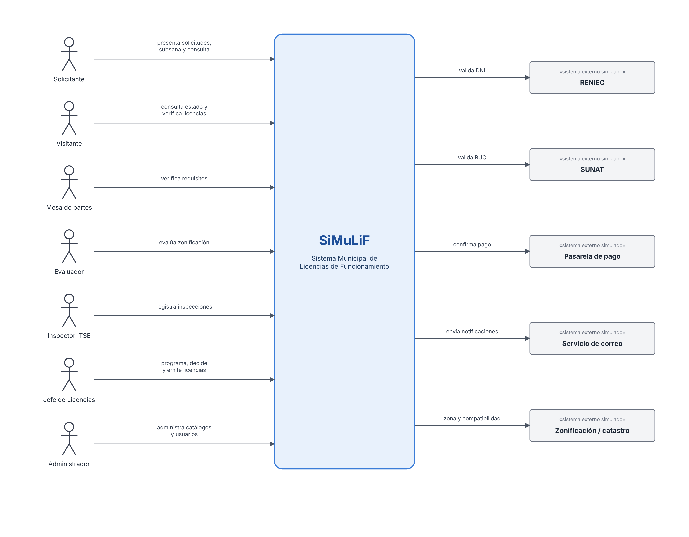

# 1. Requerimientos funcionales

| Proyecto | Curso | Entrega | Versión | Fecha |
|---|---|---|---|---|
| SiMuLiF, Sistema Municipal de Licencias de Funcionamiento (proyecto 4) | SW505 Proceso de Construcción de Software I, 2026-2 | Fase 1: análisis y diseño | 1.0 | 12/11/2026 |

## 1. Introducción

### 1.1 Propósito

Los documentos de la fase 1 especifican los requisitos y el diseño de SiMuLiF; este primero introduce el producto y detalla los requerimientos funcionales. Están dirigidos al equipo de desarrollo, al docente del curso y a quien despliegue u opere el sistema. El código, las pruebas y la base de datos se rastrean a los identificadores definidos aquí (RF, RNF, RN, CUS).

### 1.2 Alcance

SiMuLiF es una aplicación web que simula el trámite de **licencia de funcionamiento** de una municipalidad distrital peruana, desde el registro del solicitante hasta la emisión de una licencia con código QR verificable.

| Dentro del alcance (MVP) | Fuera del alcance |
|---|---|
| Registro de solicitantes (persona natural o jurídica con representante), establecimientos y actividades económicas | Cese de actividades |
| Cálculo del nivel de riesgo y de los requisitos aplicables | Modificación o transferencia de licencias, cesionarios |
| Presentación del expediente con documentos digitales y pago simulado | Pago real |
| Verificación de requisitos, evaluación de zonificación y compatibilidad de uso, ITSE previa para riesgo alto o muy alto | Integración real con SUNAT, RENIEC o catastro |
| Observaciones, subsanaciones, plazos en días hábiles, abandono y silencio administrativo positivo | Firma digital real |
| Decisión, licencia o resolución, consulta pública del estado | Aplicación móvil nativa |
| Seguridad por roles, bitácora inmutable, auditoría, logs y métricas | |

| Beneficiario | Beneficio esperado |
|---|---|
| Ciudadano | Menos tiempo y desplazamientos; requisitos claros desde el inicio; estado del trámite en línea |
| Municipalidad | Bandejas por rol, control de plazos legales, licencias verificables por QR |
| Control y transparencia | Trazabilidad completa de cada expediente y consulta pública |

### 1.3 Definiciones, acrónimos y abreviaturas

| Término | Definición |
|---|---|
| Expediente / solicitud | Conjunto de datos, documentos y actuaciones de un trámite de licencia. Código `LF-AAAA-NNNNNN`. |
| Licencia de funcionamiento | Autorización municipal para desarrollar una actividad económica en un establecimiento. Código `LIC-AAAA-NNNNNN`. |
| Giro | Actividad económica del establecimiento, codificada con CIIU. |
| CIIU | Clasificación Industrial Internacional Uniforme. |
| ITSE | Inspección Técnica de Seguridad en Edificaciones. **Posterior** (riesgo bajo o medio) o **previa** a la licencia (riesgo alto o muy alto). |
| Zonificación / compatibilidad de uso | Verificación de que el giro está permitido en la zona del predio. |
| Observación / subsanación | Defecto señalado por la municipalidad y su corrección por el solicitante dentro de un plazo. |
| Abandono | Conclusión del expediente cuando el solicitante no subsana en el plazo. |
| Silencio administrativo positivo | Aprobación automática por vencimiento del plazo sin pronunciamiento; en el MVP se alerta y se marca el expediente. |
| Días hábiles | Días de lunes a viernes que no son feriados del catálogo. |
| TUO / TUPA | Texto Único Ordenado de una ley / Texto Único de Procedimientos Administrativos de la municipalidad. |
| LPAG | Ley del Procedimiento Administrativo General (Ley 27444). |
| DNI / RUC | Documento Nacional de Identidad (8 dígitos) / Registro Único de Contribuyentes (11 dígitos). |
| UBIGEO | Código geográfico del distrito (semilla: 150131). |
| MVP | Producto mínimo viable que se entrega el 03/12/2026. |
| RF / RNF / RN | Requerimiento funcional / no funcional / regla de negocio. |
| CUN / CUS | Caso de uso del negocio / del sistema. |
| JWT / RBAC | JSON Web Token / control de acceso basado en roles. |
| MoSCoW | Priorización M (Must), S (Should), C (Could). |

### 1.4 Referencias

| Referencia | Uso en los documentos |
|---|---|
| Ley N.° 28976, Ley Marco de Licencia de Funcionamiento, y su TUO (D.S. N.° 163-2020-PCM) | Procedimiento, requisitos, plazos, silencio positivo |
| Ley N.° 27972, Ley Orgánica de Municipalidades | Competencia municipal |
| D.S. N.° 002-2018-PCM, Reglamento de ITSE | Niveles de riesgo, ITSE previa o posterior |
| TUO de la Ley N.° 27444 (LPAG) | Días hábiles, subsanación, abandono |
| Ley N.° 29733, Ley de Protección de Datos Personales | Tratamiento de datos de los solicitantes |
| IEEE Std 830-1998 e ISO/IEC/IEEE 29148:2018 | Estructura de la especificación de requisitos |
| Enunciado del proyecto 4 y teoría del curso SW505 (2026-2) | Alcance, 7 capas, calidad y entregables |

> Los plazos, montos, umbrales y requisitos del sistema son **referenciales** y están parametrizados; deben verificarse con el TUO y el TUPA vigentes antes de cualquier uso real.

### 1.5 Documentos del proyecto

| # | Documento | Contenido |
|---|---|---|
| 1 | [Requerimientos funcionales](<1. Requerimientos funcionales.md>) | Introducción, descripción general del producto y 45 requerimientos funcionales |
| 2 | [Requerimientos no funcionales](<2. Requerimientos no funcionales.md>) | Restricciones, supuestos, interfaces externas y 18 requerimientos no funcionales |
| 3 | [Análisis: casos de uso del negocio](<3. Analisis - Casos de uso del negocio.md>) | Contexto normativo, actores, CUN-01 a CUN-07, diagrama de actividades y reglas RN-01 a RN-15 |
| 4 | [Modelo lógico de datos](<4. Modelo lógico de datos.md>) | Diagrama ER, diccionario de entidades, modelo documental y de objetos, normalización |
| 5 | [Diseño: casos de uso del sistema](<5. Diseño - Casos de uso del sistema.md>) | Actores, CUS-01 a CUS-20, máquina de estados y matriz de trazabilidad |
| 6 | [Modelo físico de datos](<6. Modelo físico de datos.md>) | PostgreSQL, MongoDB y MinIO, con los scripts completos en anexos |
| 7 | [Diseño de arquitectura](<7. Diseño de arquitectura.md>) | Capas, componentes, despliegue, API, seguridad, patrones y estructura del repositorio |
| 8 | [Plan de implementación](<../implementacion_y_despliegue/8. Plan de implementación.md>) | Roles, incrementos con tareas por integrante, flujo de Git, definición de terminado y riesgos |
| 9 | [Guía de despliegue y operaciones](<../implementacion_y_despliegue/9. Guía de despliegue y operaciones.md>) | Entornos, despliegue con Docker paso a paso, variables, respaldo, actualización y solución de problemas |

## 2. Descripción general

### 2.1 Perspectiva del producto

*Figura: Diagrama de contexto.*

SiMuLiF es un sistema nuevo e independiente. Es una SPA (React) que consume una API REST (FastAPI), detrás de un proxy inverso Nginx, con tres almacenes de datos: PostgreSQL para los datos estructurados del trámite, MongoDB para los datos semiestructurados (observaciones, formularios de inspección, bitácora, auditoría y notificaciones) y MinIO para los archivos. Los servicios externos (RENIEC, SUNAT, pasarela de pago, correo y zonificación) se simulan mediante adaptadores. La arquitectura se organiza en las 7 capas exigidas por el curso (ver §9).

### 2.2 Funciones del producto

| Módulo | Función |
|---|---|
| M1 | Registro de solicitantes, representantes, cuentas y establecimientos |
| M2 | Dirección, actividad económica, características del local y cálculo del riesgo |
| M3 | Creación del expediente, requisitos aplicables, carga de documentos, pago y presentación |
| M4 | Validación automática y verificación de requisitos por mesa de partes |
| M5 | Evaluación de zonificación y compatibilidad de uso |
| M6 | Programación y registro de inspecciones ITSE |
| M7 | Observaciones, subsanaciones y abandono |
| M8 | Decisión, licencia con QR y resoluciones |
| M9 | Consulta del solicitante, consulta pública, verificación de licencias y bandejas |
| MT | Autenticación, roles, notificaciones, bitácora, auditoría, plazos, catálogos, usuarios e indicadores |

### 2.3 Características de los usuarios

| Usuario | Rol | Perfil | Uso esperado |
|---|---|---|---|
| Solicitante | `SOLICITANTE` | Ciudadano o representante de empresa; manejo básico de la web | Ocasional, desde PC o celular |
| Visitante | sin sesión | Cualquier persona | Consulta pública y verificación de licencias |
| Mesa de partes | `MESA_PARTES` | Personal administrativo | Diario |
| Evaluador | `EVALUADOR` | Técnico de licencias | Diario |
| Inspector | `INSPECTOR` | Inspector ITSE | Diario, a veces desde tablet |
| Jefe | `JEFE` | Subgerente de licencias | Diario, decisiones e indicadores |
| Administrador | `ADMIN` | Personal de TI | Configuración de catálogos y usuarios |

## 3. Requerimientos funcionales

### Convenciones

| Columna | Significado |
|---|---|
| ID | `RF-<módulo><nn>`. El módulo corresponde a los 9 módulos funcionales del enunciado (M1 a M9) más los transversales (MT). |
| Prior. | MoSCoW: **M** = Must (obligatorio en el MVP), **S** = Should (deseable), **C** = Could (si alcanza el tiempo). |
| Criterio de aceptación | Condición verificable; es la base de las pruebas de la fase 2. |
| Trazabilidad | Caso de uso de sistema (CUS) y regla de negocio (RN) relacionados. Ver [05_casos_uso_sistema.md](<5. Diseño - Casos de uso del sistema.md>) y [03_casos_uso_negocio.md](<3. Analisis - Casos de uso del negocio.md>). |

---

### M1. Registro de solicitantes, representantes y establecimientos

| ID | Prior. | Requerimiento | Criterio de aceptación | Trazabilidad |
|---|:---:|---|---|---|
| **RF-101** | M | **Registrar solicitante persona natural.** El sistema registra a una persona natural con DNI, nombres, apellidos, correo, teléfono y dirección de contacto. | El DNI tiene 8 dígitos y se valida contra el adaptador RENIEC simulado; si el DNI ya existe, no se crea un duplicado y se informa al usuario. | CUS-02, RN-10 |
| **RF-102** | M | **Registrar solicitante persona jurídica.** El sistema registra una persona jurídica con RUC, razón social, domicilio fiscal, correo y teléfono. | El RUC tiene 11 dígitos, empieza en 10 o 20 y se valida contra el adaptador SUNAT simulado; el RUC debe figurar como ACTIVO y HABIDO. | CUS-02, RN-10 |
| **RF-103** | M | **Registrar representante legal.** Para personas jurídicas, el sistema registra uno o más representantes con DNI, nombres, cargo, número de partida/asiento del poder y fecha de vigencia del poder. | Una persona jurídica no puede presentar un expediente sin al menos un representante con poder vigente. | CUS-02, RN-01 |
| **RF-104** | M | **Registrar cuenta de usuario del ciudadano.** El ciudadano crea su cuenta (correo y contraseña) vinculada a un solicitante. | La contraseña tiene al menos 8 caracteres con letras y números; el correo es único. | CUS-01 |
| **RF-105** | M | **Registrar establecimiento.** El solicitante registra uno o más establecimientos con nombre comercial y dirección. | Un establecimiento siempre pertenece a un solicitante. | CUS-03 |

### M2. Dirección, actividad económica y características del local

| ID | Prior. | Requerimiento | Criterio de aceptación | Trazabilidad |
|---|:---:|---|---|---|
| **RF-201** | M | **Registrar dirección del local.** Dirección, referencia, ubigeo (distrito) y código catastral/zona del predio, que se elige de la tabla de zonificación de referencia. | El ubigeo pertenece a la municipalidad configurada; la zona existe en el catálogo. | CUS-03 |
| **RF-202** | M | **Registrar actividad económica.** Giro principal elegido del catálogo CIIU. | Solo se aceptan giros activos del catálogo. | CUS-03 |
| **RF-203** | M | **Registrar características del local.** Área ocupada (m²), aforo, número de pisos, si funciona en sótano y si es un inmueble declarado patrimonio cultural. | Área > 0 y ≤ 50 000; aforo ≥ 1; pisos ≥ 1. Los valores fuera de rango se rechazan con mensaje. | CUS-03 |
| **RF-204** | M | **Calcular el nivel de riesgo.** El sistema calcula el nivel de riesgo (BAJO, MEDIO, ALTO, MUY_ALTO) con el riesgo base del giro y los umbrales de área y aforo parametrizados. El evaluador puede reclasificarlo con sustento. | El nivel calculado es el máximo entre el riesgo del giro, el del área y el del aforo (ver RN-02). La reclasificación queda en bitácora. | CUS-03, CUS-08, RN-02 |

### M3. Presentación del expediente y carga de documentos

| ID | Prior. | Requerimiento | Criterio de aceptación | Trazabilidad |
|---|:---:|---|---|---|
| **RF-301** | M | **Crear solicitud.** El solicitante crea una solicitud en estado BORRADOR eligiendo establecimiento y procedimiento (Licencia indeterminada o Licencia temporal). | No se puede crear una solicitud para un establecimiento que ya tiene licencia vigente para el mismo giro (RN-03). | CUS-04 |
| **RF-302** | M | **Mostrar requisitos aplicables.** El sistema muestra la lista de requisitos según el procedimiento, el tipo de persona, el nivel de riesgo y las condiciones especiales del local. | Para riesgo BAJO/MEDIO pide la declaración jurada de condiciones de seguridad; para ALTO/MUY_ALTO pide los requisitos de ITSE previa; para persona jurídica pide la vigencia de poder. | CUS-04, RN-02, RN-04 |
| **RF-303** | M | **Cargar documentos.** El solicitante adjunta archivos por requisito. | Formatos PDF, JPG o PNG; máximo 10 MB por archivo; se calcula y guarda el hash SHA-256; el archivo se guarda en almacenamiento de objetos y en la BD solo quedan los metadatos. | CUS-05, RN-11 |
| **RF-304** | M | **Registrar pago del derecho de trámite.** El sistema registra el pago mediante la pasarela simulada y guarda el código de operación. | Sin pago CONFIRMADO no se puede presentar el expediente (RN-05). | CUS-06, RN-05 |
| **RF-305** | M | **Firmar declaración jurada y presentar.** El solicitante acepta la declaración jurada y presenta el expediente. | Al presentar, el sistema asigna un código único `LF-AAAA-NNNNNN`, cambia el estado a PRESENTADO, calcula la fecha límite en días hábiles y genera el cargo de recepción en PDF. | CUS-04, RN-06 |
| **RF-306** | S | **Editar o anular borrador.** El solicitante puede editar o eliminar una solicitud mientras esté en BORRADOR. | Una solicitud presentada no se puede editar ni eliminar. | CUS-04 |

### M4. Validación de requisitos

| ID | Prior. | Requerimiento | Criterio de aceptación | Trazabilidad |
|---|:---:|---|---|---|
| **RF-401** | M | **Validación automática de completitud.** Antes de presentar, el sistema verifica que todos los requisitos obligatorios tengan al menos un documento. | Si falta alguno, se bloquea la presentación y se listan los faltantes. | CUS-04, RN-04 |
| **RF-402** | M | **Verificación por mesa de partes.** El personal de mesa de partes marca cada requisito como CONFORME u OBSERVADO. | Si todos están CONFORME, el expediente pasa a EN_EVALUACION; si alguno está OBSERVADO, pasa a OBSERVADO (ver M7). | CUS-07, RN-07 |
| **RF-403** | S | **Validar vigencia de poder.** El sistema advierte si la fecha de vigencia del poder del representante está vencida. | Con poder vencido el requisito queda OBSERVADO automáticamente. | CUS-07, RN-01 |

### M5. Compatibilidad de uso y zonificación

| ID | Prior. | Requerimiento | Criterio de aceptación | Trazabilidad |
|---|:---:|---|---|---|
| **RF-501** | M | **Consultar zonificación de referencia.** El sistema obtiene la zona del predio y la matriz de compatibilidad zona-giro desde el adaptador de zonificación (datos de referencia cargados). | La consulta devuelve COMPATIBLE, NO_COMPATIBLE o NO_REGISTRADO. | CUS-08 |
| **RF-502** | M | **Registrar evaluación de compatibilidad.** El evaluador confirma o corrige el resultado con un sustento escrito. | Si el resultado es NO_COMPATIBLE, el sistema propone la denegatoria y el expediente pasa a PENDIENTE_DECISION (RN-08). Si es COMPATIBLE, pasa a EN_INSPECCION (riesgo ALTO/MUY_ALTO) o a PENDIENTE_DECISION (riesgo BAJO/MEDIO). | CUS-08, RN-02, RN-08 |

### M6. Inspecciones y condiciones de seguridad

| ID | Prior. | Requerimiento | Criterio de aceptación | Trazabilidad |
|---|:---:|---|---|---|
| **RF-601** | M | **Programar inspección.** El jefe asigna inspector y fecha. Para riesgo ALTO/MUY_ALTO es ITSE **previa**; para BAJO/MEDIO es ITSE **posterior** y se programa después de emitir la licencia. | La fecha programada no puede ser anterior a hoy; un inspector no puede tener dos inspecciones en el mismo horario. | CUS-09, RN-02 |
| **RF-602** | M | **Registrar checklist de inspección.** El inspector llena una lista de verificación cuyos ítems dependen del giro y del nivel de riesgo (formulario variable), y adjunta fotos. | El formulario se guarda en la base NoSQL con referencia a la inspección; cada ítem tiene respuesta CUMPLE/NO_CUMPLE/NO_APLICA. | CUS-10 |
| **RF-603** | M | **Registrar resultado de inspección.** FAVORABLE o DESFAVORABLE, con observaciones si corresponde. | DESFAVORABLE en ITSE previa genera observaciones y el expediente pasa a OBSERVADO; FAVORABLE lo pasa a PENDIENTE_DECISION. En ITSE posterior, un DESFAVORABLE genera una alerta al jefe (no cambia la licencia automáticamente). | CUS-10, RN-09 |

### M7. Observaciones y subsanaciones

| ID | Prior. | Requerimiento | Criterio de aceptación | Trazabilidad |
|---|:---:|---|---|---|
| **RF-701** | M | **Registrar observación.** Mesa de partes, evaluador o inspector registran observaciones con descripción, requisito relacionado (opcional) y etapa de origen. | El expediente pasa a OBSERVADO; se fija el plazo de subsanación en días hábiles (parámetro) y se notifica al solicitante. | CUS-11, RN-07 |
| **RF-702** | M | **Subsanar observación.** El solicitante responde cada observación con comentario y documentos nuevos. | Solo dentro del plazo; cuando todas las observaciones están respondidas, el expediente pasa a SUBSANADO y vuelve a la etapa que lo observó. Se permiten varias rondas. | CUS-12, RN-07 |
| **RF-703** | M | **Declarar abandono.** Un proceso programado revisa diariamente los expedientes OBSERVADO con plazo vencido. | Los pasa a ABANDONADO, registra el evento y notifica. | CUS-20, RN-07 |
| **RF-704** | S | **Levantar u observar de nuevo.** El funcionario revisa la subsanación y marca cada observación como LEVANTADA o REITERADA. | Si hay alguna REITERADA, vuelve a OBSERVADO con nuevo plazo. | CUS-11 |

### M8. Decisión y licencia simulada

| ID | Prior. | Requerimiento | Criterio de aceptación | Trazabilidad |
|---|:---:|---|---|---|
| **RF-801** | M | **Registrar decisión.** El jefe registra APROBADA, DENEGADA o IMPROCEDENTE con sustento. | Solo se puede aprobar si la zonificación es COMPATIBLE y, para riesgo ALTO/MUY_ALTO, la ITSE previa es FAVORABLE (RN-08). | CUS-13, RN-08 |
| **RF-802** | M | **Generar licencia simulada.** Al aprobar, el sistema genera la licencia en PDF con número `LIC-AAAA-NNNNNN`, titular, establecimiento, dirección, giro, área, aforo, nivel de riesgo, tipo de vigencia (indeterminada o fecha fin) y código QR de verificación, con la marca de agua "DOCUMENTO SIMULADO". | El PDF se guarda en almacenamiento de objetos y el expediente pasa a LICENCIA_EMITIDA. | CUS-14, RN-12 |
| **RF-803** | S | **Generar resolución de denegatoria/improcedencia.** PDF con el sustento. | Queda disponible para descarga del solicitante. | CUS-13 |
| **RF-804** | M | **Descargar documentos emitidos.** El solicitante descarga su cargo, licencia o resolución mediante un enlace temporal. | El enlace expira en 15 minutos; solo el titular y el personal interno pueden descargar. | CUS-15 |

### M9. Consulta y seguimiento

| ID | Prior. | Requerimiento | Criterio de aceptación | Trazabilidad |
|---|:---:|---|---|---|
| **RF-901** | M | **Consultar mis expedientes.** El solicitante ve la lista de sus expedientes, el estado y la línea de tiempo de eventos. | Solo ve los suyos. | CUS-15 |
| **RF-902** | M | **Consulta pública de estado.** Cualquier persona consulta el estado con código de expediente + número de documento del solicitante. | Muestra solo estado, fechas y etapa; el documento aparece enmascarado (RNF-03). | CUS-16 |
| **RF-903** | M | **Verificar licencia por QR o número.** Página pública que confirma si una licencia existe y está VIGENTE. | Muestra número, nombre comercial, dirección, giro y estado; nada más. | CUS-16, RN-12 |
| **RF-904** | M | **Bandeja de trabajo por rol.** Cada funcionario ve los expedientes que le corresponden según su rol y estado, con filtros por estado, fecha, riesgo y código, y ordenados por fecha límite. | Los expedientes con fecha límite en ≤ 1 día hábil aparecen resaltados. | CUS-17 |

### MT. Transversales

| ID | Prior. | Requerimiento | Criterio de aceptación | Trazabilidad |
|---|:---:|---|---|---|
| **RF-T01** | M | **Autenticación.** Inicio de sesión con usuario y contraseña; emite un token JWT con el rol. | 5 intentos fallidos bloquean la cuenta 15 minutos. | CUS-01 |
| **RF-T02** | M | **Autorización por roles.** Roles: SOLICITANTE, MESA_PARTES, EVALUADOR, INSPECTOR, JEFE, ADMIN. | Cada endpoint valida el rol; un acceso no autorizado devuelve 403 y se audita. | RNF-01 |
| **RF-T03** | M | **Notificaciones.** Cada cambio de estado relevante envía una notificación por correo (adaptador simulado que registra el envío y lo muestra en la bandeja del ciudadano). | Estados notificados: PRESENTADO, OBSERVADO, ABANDONADO, LICENCIA_EMITIDA, DENEGADO, IMPROCEDENTE. | RN-13 |
| **RF-T04** | M | **Bitácora del expediente.** Todo cambio de estado y acción relevante registra usuario, fecha, estado anterior, estado nuevo y detalle. | Los eventos no se pueden modificar ni borrar desde la aplicación. | RN-14 |
| **RF-T05** | M | **Auditoría de accesos.** Se registran inicios de sesión, accesos denegados, descargas de documentos y cambios de catálogos (usuario, IP, acción, recurso, resultado). | Cada evento queda en la colección `auditoria`; un acceso denegado registra la IP y el resultado DENEGADO. | CUS-19 |
| **RF-T06** | S | **Control de plazos y silencio positivo.** Un proceso diario calcula los días hábiles restantes; alerta al jefe cuando faltan ≤ 1 día y marca `silencio_positivo_aplicable` cuando vence el plazo legal sin decisión. | Usa el calendario de feriados configurado. | CUS-20, RN-06 |
| **RF-T07** | M | **Administrar catálogos.** El administrador mantiene procedimientos, requisitos, giros CIIU, zonas, matriz de compatibilidad, umbrales de riesgo, plazos y feriados. | Los cambios aplican a las solicitudes nuevas sin modificar el código y quedan en auditoría. | CUS-18 |
| **RF-T08** | M | **Administrar usuarios internos.** Crear, desactivar y asignar roles al personal municipal. | Un usuario desactivado no puede iniciar sesión; los cambios de rol quedan en auditoría. | CUS-18 |
| **RF-T09** | S | **Panel de indicadores.** Expedientes por estado, tiempo promedio de atención, licencias emitidas por mes y por nivel de riesgo, expedientes por vencer. | Los indicadores coinciden con los datos de la BD para el rango de fechas elegido. | CUS-19 |
| **RF-T10** | C | **Exportar reportes.** Exportar a CSV los reportes del panel. | El CSV respeta los filtros aplicados en el panel. | CUS-19 |

---

### Resumen

| Módulo | M | S | C | Total |
|---|---|---|---|---|
| M1 Registro | 5 | 0 | 0 | 5 |
| M2 Local y actividad | 4 | 0 | 0 | 4 |
| M3 Expediente | 5 | 1 | 0 | 6 |
| M4 Requisitos | 2 | 1 | 0 | 3 |
| M5 Zonificación | 2 | 0 | 0 | 2 |
| M6 Inspección | 3 | 0 | 0 | 3 |
| M7 Observaciones | 3 | 1 | 0 | 4 |
| M8 Decisión y licencia | 3 | 1 | 0 | 4 |
| M9 Consulta | 4 | 0 | 0 | 4 |
| MT Transversales | 7 | 2 | 1 | 10 |
| **Total** | **38** | **6** | **1** | **45** |

**Fuera de alcance del MVP:** cese de actividades, modificación/transferencia de licencia, cesionarios, pago real, integración real con SUNAT/RENIEC/catastro, firma digital real y app móvil nativa.

### Alcance acotado al equipo y al tiempo

El alcance se ajustó a **3 desarrolladores** y **3 semanas de construcción** (13/11 al 03/12):

| Grupo | Requerimientos | Compromiso |
|---|---|---|
| Obligatorios (M) | 38 RF | Se entregan todos el 03/12; son el flujo completo de un expediente, de la solicitud a la licencia |
| Deseables (S) | RF-306, RF-403, RF-704, RF-803, RF-T06, RF-T09 | Solo si los M están terminados y probados; si no, pasan a una versión posterior |
| Opcional (C) | RF-T10 | Fuera del MVP salvo que sobre tiempo |

| Simplificación | Motivo |
|---|---|
| Un solo distrito y un procedimiento con dos variantes (indeterminada y temporal) | Evitar configuraciones múltiples |
| RENIEC, SUNAT, pago, correo y zonificación simulados con datos fijos | Sin dependencias externas ni costos |
| Catálogos (giros, zonas, requisitos, umbrales) cargados por semilla; la pantalla de administración cubre lo básico | Menos pantallas que construir |
| 6 roles con permisos fijos (sin roles configurables) | Autorización simple y fácil de probar |
| Notificaciones solo dentro del sistema y en MailHog (sin correo real) | Sin servidor de correo |
