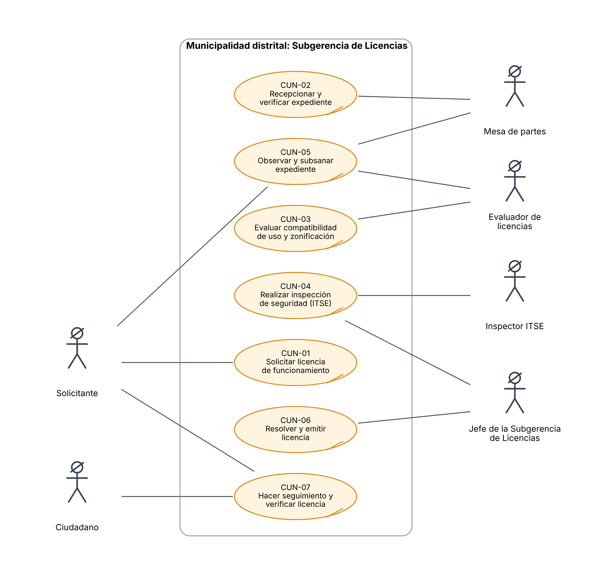
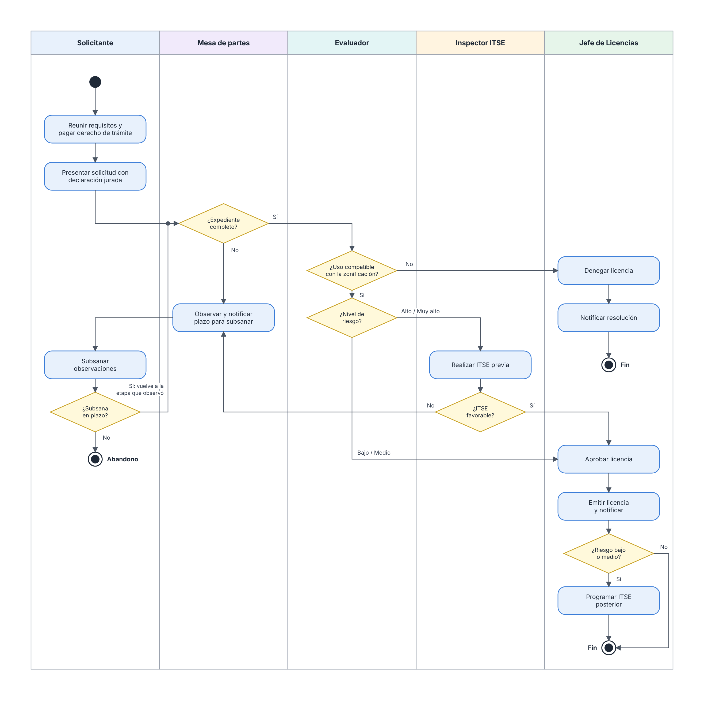

# 3. Análisis: casos de uso del negocio

| Proyecto | Curso | Entrega | Versión | Fecha |
|---|---|---|---|---|
| SiMuLiF, Sistema Municipal de Licencias de Funcionamiento (proyecto 4) | SW505 Proceso de Construcción de Software I, 2026-2 | Fase 1: análisis y diseño | 1.0 | 12/11/2026 |

Este documento describe **cómo funciona el negocio** de la municipalidad (el trámite de licencias), sin hablar todavía del software.

## 1. Contexto normativo

| Norma | Qué aporta al modelo de negocio |
|---|---|
| Ley N.° 28976, Ley Marco de Licencia de Funcionamiento, y su TUO (D.S. N.° 163-2020-PCM) | Define la licencia, los requisitos, los aspectos a evaluar (zonificación/compatibilidad de uso y condiciones de seguridad), los plazos y el silencio administrativo positivo |
| Ley N.° 27972, Ley Orgánica de Municipalidades | Da a la municipalidad la competencia para otorgar licencias de funcionamiento |
| D.S. N.° 002-2018-PCM, Reglamento de Inspecciones Técnicas de Seguridad en Edificaciones (ITSE) | Clasifica el riesgo (bajo, medio, alto, muy alto) y define si la ITSE es posterior o previa al otorgamiento de la licencia |
| TUO de la Ley N.° 27444, Ley del Procedimiento Administrativo General | Cómputo en días hábiles, observaciones y plazo para subsanar, abandono, silencio administrativo |
| Ley N.° 29733, Ley de Protección de Datos Personales | Tratamiento de los datos de los solicitantes |

> Los plazos y requisitos concretos dependen del TUO vigente y del TUPA de cada municipalidad. Por eso el sistema los **parametriza** (RN-06, RNF-15). Los valores semilla del proyecto son referenciales.

## 2. Actores del negocio

| Actor del negocio | Tipo | Descripción |
|---|---|---|
| Solicitante | Externo | Persona natural o jurídica (a través de su representante legal) que quiere operar un establecimiento comercial |
| Ciudadano | Externo | Cualquier persona que consulta el estado de un trámite o verifica una licencia |
| Mesa de partes | Interno | Recibe el expediente y verifica que esté completo |
| Evaluador de licencias | Interno | Evalúa la zonificación y la compatibilidad de uso |
| Inspector ITSE | Interno | Inspecciona las condiciones de seguridad del local |
| Jefe de la Subgerencia de Licencias | Interno | Programa inspecciones, decide y firma la licencia o la resolución |
| SUNAT / RENIEC | Externo (sistema) | Fuentes de validación de RUC y DNI (simuladas en el MVP) |
| Entidad financiera / caja municipal | Externo (sistema) | Cobra el derecho de trámite (simulada) |
| Área de catastro | Interno (sistema) | Fuente de zonificación del predio (datos de referencia) |

## 3. Diagrama de casos de uso del negocio

*Figura: Diagrama de casos de uso del negocio (UML).*

## 4. Especificación de los casos de uso del negocio

### CUN-01 Solicitar licencia de funcionamiento

| Campo | Detalle |
|---|---|
| **Actor** | Solicitante |
| **Objetivo** | Obtener la autorización municipal para desarrollar una actividad económica en un local. |
| **Disparador** | El solicitante quiere abrir o formalizar un establecimiento en el distrito. |
| **Flujo básico** | 1) Identifica el procedimiento y los requisitos según su tipo de persona y el riesgo del local. 2) Reúne los documentos. 3) Paga el derecho de trámite. 4) Presenta la solicitud con carácter de declaración jurada y sus anexos. 5) Recibe el número de expediente y el cargo. |
| **Resultado** | Expediente admitido a trámite. |
| **Reglas de negocio** | RN-01, RN-02, RN-04, RN-05, RN-10 |

### CUN-02 Recepcionar y verificar expediente

| Campo | Detalle |
|---|---|
| **Actor** | Mesa de partes |
| **Objetivo** | Asegurar que el expediente tenga todos los requisitos antes de evaluarlo. |
| **Flujo básico** | 1) Recibe el expediente. 2) Revisa cada requisito. 3a) Si está completo, lo deriva a evaluación. 3b) Si falta algo, lo observa (ver CUN-05). |
| **Resultado** | Expediente admitido para evaluación u observado. |
| **Reglas de negocio** | RN-01, RN-04, RN-07 |

### CUN-03 Evaluar compatibilidad de uso y zonificación

| Campo | Detalle |
|---|---|
| **Actor** | Evaluador |
| **Objetivo** | Determinar si el giro solicitado está permitido en la zona del predio. |
| **Flujo básico** | 1) Ubica el predio en el plano de zonificación. 2) Contrasta el giro con el índice de usos compatibles. 3) Registra el resultado con sustento. 4) Si es compatible y el riesgo es alto o muy alto, deriva a inspección previa; si es bajo o medio, deriva a decisión. Si no es compatible, propone la denegatoria. |
| **Resultado** | Informe de compatibilidad. |
| **Reglas de negocio** | RN-02, RN-08 |

### CUN-04 Realizar inspección de seguridad (ITSE)

| Campo | Detalle |
|---|---|
| **Actores** | Jefe (programa), Inspector (ejecuta) |
| **Objetivo** | Verificar las condiciones de seguridad del local según su nivel de riesgo. |
| **Flujo básico** | 1) El jefe programa la fecha y asigna inspector. 2) El inspector visita el local y llena la lista de verificación. 3) Registra el resultado (favorable o desfavorable) con evidencias. |
| **Variantes** | *ITSE previa* (riesgo alto y muy alto) antes de decidir; *ITSE posterior* (riesgo bajo y medio) después de emitir la licencia. |
| **Reglas de negocio** | RN-02, RN-09 |

### CUN-05 Observar y subsanar expediente

| Campo | Detalle |
|---|---|
| **Actores** | Mesa de partes / Evaluador / Inspector (observan), Solicitante (subsana) |
| **Objetivo** | Permitir corregir deficiencias sin rechazar el trámite. |
| **Flujo básico** | 1) El funcionario registra las observaciones y se notifica al solicitante. 2) El solicitante tiene un plazo en días hábiles para subsanar. 3) Si subsana, el expediente vuelve a la etapa que lo observó. 4) Si el plazo vence sin respuesta, se declara el abandono. |
| **Reglas de negocio** | RN-07 |

### CUN-06 Resolver y emitir licencia

| Campo | Detalle |
|---|---|
| **Actor** | Jefe de Licencias |
| **Objetivo** | Emitir el pronunciamiento final. |
| **Flujo básico** | 1) Revisa el expediente con los informes. 2) Aprueba, deniega o declara improcedente con sustento. 3) Si aprueba, emite la licencia (indeterminada o temporal) y se notifica. 4) Para riesgo bajo/medio, programa la ITSE posterior. |
| **Reglas de negocio** | RN-03, RN-06, RN-08, RN-12, RN-15 |

### CUN-07 Hacer seguimiento y verificar licencia

| Campo | Detalle |
|---|---|
| **Actores** | Solicitante, Ciudadano |
| **Objetivo** | Conocer el estado del trámite y verificar la autenticidad de una licencia. |
| **Flujo básico** | Consulta con el código de expediente y su documento; o escanea el QR de una licencia para verificar su vigencia. |
| **Reglas de negocio** | RN-12, RNF-03 |

## 5. Diagrama de actividades del proceso de negocio

*Figura: Diagrama de actividades del proceso de negocio.*

## 6. Reglas de negocio

| ID | Regla |
|---|---|
| RN-01 | Una persona jurídica actúa mediante un representante legal con poder vigente; con el poder vencido, el requisito se observa. |
| RN-02 | El nivel de riesgo es el máximo entre el riesgo base del giro (CIIU) y los niveles que resultan del área y del aforo según umbrales parametrizados. BAJO/MEDIO → ITSE posterior; ALTO/MUY_ALTO → ITSE previa. El evaluador puede reclasificarlo con sustento. |
| RN-03 | Un establecimiento no puede tener dos licencias VIGENTES para el mismo giro ni dos solicitudes en trámite para el mismo giro. |
| RN-04 | Los requisitos exigibles dependen del procedimiento, el tipo de persona, el nivel de riesgo y condiciones especiales (patrimonio cultural, giros que requieren autorización sectorial o título profesional). |
| RN-05 | No se admite un expediente sin el pago confirmado del derecho de trámite. |
| RN-06 | Los plazos se cuentan en días hábiles (excluye sábados, domingos y feriados del catálogo). El plazo máximo de evaluación es un parámetro por nivel de riesgo (semilla referencial: 4 días hábiles para BAJO/MEDIO y 10 para ALTO/MUY_ALTO; verificar con el TUO vigente). Si vence sin decisión, el sistema alerta y marca el expediente como sujeto a silencio administrativo positivo. Las observaciones suspenden el cómputo. |
| RN-07 | Una observación otorga un plazo para subsanar (parámetro; semilla: 2 días hábiles, verificar con el TUO de la LPAG). Si vence sin subsanar, el expediente pasa a ABANDONADO. Al subsanar, el expediente vuelve a la etapa que lo observó. |
| RN-08 | Solo se aprueba si la compatibilidad de uso es COMPATIBLE y, para riesgo ALTO/MUY_ALTO, la ITSE previa es FAVORABLE. Con uso NO_COMPATIBLE se deniega. |
| RN-09 | Un resultado DESFAVORABLE en ITSE posterior genera una alerta al jefe para iniciar las acciones de fiscalización (fuera del alcance del MVP); no anula la licencia automáticamente. |
| RN-10 | DNI y RUC son únicos por solicitante y se validan con las fuentes externas (simuladas). |
| RN-11 | Los documentos se aceptan en PDF/JPG/PNG de hasta 10 MB y se guarda su hash SHA-256 para garantizar su integridad. |
| RN-12 | Cada licencia tiene un número correlativo único por año y un código de verificación (QR). Vigencia indeterminada o temporal con fecha de fin. |
| RN-13 | Todo cambio de estado relevante se notifica al solicitante. |
| RN-14 | Todo cambio de estado registra usuario, fecha, estado anterior, estado nuevo y motivo; la bitácora es inmutable. |
| RN-15 | Solo el JEFE registra la decisión final; quien inspeccionó un expediente no puede decidirlo (separación de funciones). |
