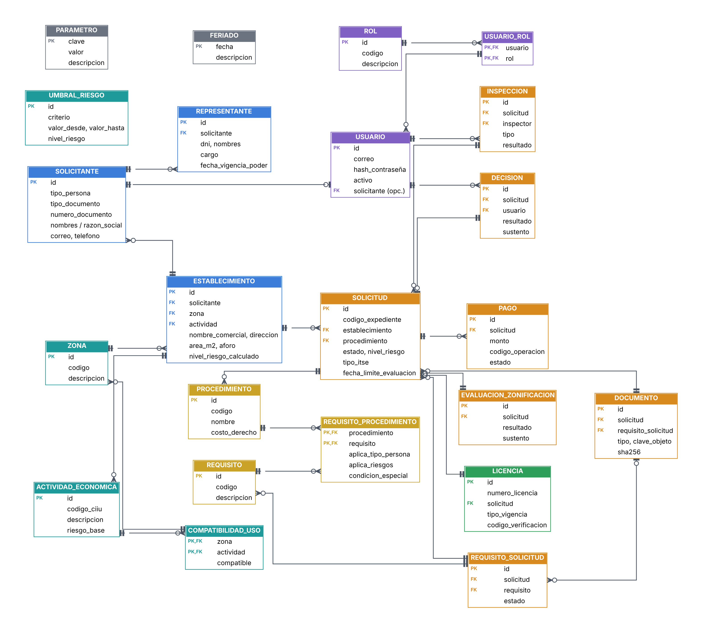

# 4. Modelo lógico de datos

| Proyecto | Curso | Entrega | Versión | Fecha |
|---|---|---|---|---|
| SiMuLiF, Sistema Municipal de Licencias de Funcionamiento (proyecto 4) | SW505 Proceso de Construcción de Software I, 2026-2 | Fase 1: análisis y diseño | 1.0 | 12/11/2026 |

El modelo lógico describe **qué información** maneja el sistema y cómo se relaciona, independiente del motor de base de datos. Se divide según el tipo de dato que exige el enunciado:

| Tipo | Criterio | Datos |
|---|---|---|
| **Relacional (SQL)** | Estructura fija, relaciones e integridad referencial, transacciones | Solicitantes, establecimientos, solicitudes, requisitos, pagos, inspecciones, decisiones, licencias, usuarios, catálogos |
| **Documental (NoSQL)** | Estructura variable, historial que solo crece, alto volumen de escritura | Observaciones con sus rondas de respuesta, formularios de inspección, plantillas de checklist, eventos del expediente, auditoría, notificaciones |
| **Objetos (archivos)** | Binarios grandes | Documentos del expediente, fotos de inspección, cargos, licencias y resoluciones en PDF |

## 1. Diagrama entidad-relación (parte relacional)

*Figura: Diagrama entidad-relación (modelo lógico).*

Catálogos de configuración sin relación fuerte: **UMBRAL_RIESGO**, **PARAMETRO**, **FERIADO**.

## 2. Diccionario de entidades

### Personas y accesos
| Entidad | Atributos (lógicos) | Notas |
|---|---|---|
| **SOLICITANTE** | id, tipo_persona (NATURAL/JURIDICA), tipo_documento (DNI/RUC), numero_documento, nombres, apellidos, razon_social, correo, telefono, direccion_contacto, fecha_registro | numero_documento único (RN-10) |
| **REPRESENTANTE** | id, solicitante, dni, nombres, apellidos, cargo, partida_registral, asiento, fecha_vigencia_poder | Solo para persona jurídica (RN-01) |
| **USUARIO** | id, correo/usuario, hash_contraseña, nombres, activo, intentos_fallidos, bloqueado_hasta, solicitante (opcional) | Ciudadano o personal interno |
| **ROL** | id, codigo (SOLICITANTE, MESA_PARTES, EVALUADOR, INSPECTOR, JEFE, ADMIN), descripcion | |
| **USUARIO_ROL** | usuario, rol | Relación N:M |

### Establecimiento y catálogos de evaluación
| Entidad | Atributos | Notas |
|---|---|---|
| **ESTABLECIMIENTO** | id, solicitante, nombre_comercial, direccion, referencia, ubigeo, codigo_catastral, zona, actividad, area_m2, aforo, numero_pisos, tiene_sotano, es_patrimonio_cultural, nivel_riesgo_calculado | |
| **ACTIVIDAD_ECONOMICA** | id, codigo_ciiu, descripcion, riesgo_base, requiere_autorizacion_sectorial, requiere_titulo_profesional, activo | Catálogo de giros |
| **ZONA** | id, codigo (ej. CZ, CV, RDM, I1), descripcion, ubigeo | Datos de referencia de zonificación |
| **COMPATIBILIDAD_USO** | zona, actividad, compatible (S/N), observacion | Índice de usos compatibles (zona × giro) |
| **UMBRAL_RIESGO** | id, criterio (AREA/AFORO), valor_desde, valor_hasta, nivel_riesgo | Parametriza RN-02 |

### Procedimiento y requisitos
| Entidad | Atributos | Notas |
|---|---|---|
| **PROCEDIMIENTO** | id, codigo (LF_INDETERMINADA, LF_TEMPORAL), nombre, costo_derecho, activo | |
| **REQUISITO** | id, codigo, descripcion, formato_permitido | |
| **REQUISITO_PROCEDIMIENTO** | procedimiento, requisito, obligatorio, aplica_tipo_persona (NATURAL/JURIDICA/AMBAS), aplica_riesgos (lista), condicion_especial (NINGUNA/PATRIMONIO/AUT_SECTORIAL/TITULO_PROF) | Regla RN-04 en datos |

### Expediente
| Entidad | Atributos | Notas |
|---|---|---|
| **SOLICITUD** | id, codigo_expediente, solicitante, establecimiento, procedimiento, estado, nivel_riesgo, tipo_itse (PREVIA/POSTERIOR), etapa_observada, fecha_creacion, fecha_presentacion, fecha_limite_evaluacion, fecha_limite_subsanacion, dias_suspendidos, silencio_positivo_aplicable, fecha_fin_vigencia_solicitada | El nivel de riesgo se copia del establecimiento al presentar (foto del momento) |
| **REQUISITO_SOLICITUD** | id, solicitud, requisito, obligatorio, estado (PENDIENTE/ADJUNTADO/CONFORME/OBSERVADO), comentario_verificacion | Checklist concreto del expediente |
| **DOCUMENTO** | id, solicitud, requisito_solicitud (opcional), tipo (REQUISITO/SUBSANACION/FOTO_INSPECCION/CARGO/LICENCIA/RESOLUCION), nombre_original, clave_objeto, tipo_mime, tamano_bytes, sha256, subido_por, fecha_subida | Metadatos; el binario está en almacenamiento de objetos |
| **PAGO** | id, solicitud, monto, codigo_operacion, estado (PENDIENTE/CONFIRMADO/RECHAZADO), fecha | Pasarela simulada |
| **EVALUACION_ZONIFICACION** | id, solicitud, zona, resultado (COMPATIBLE/NO_COMPATIBLE/NO_REGISTRADO), sustento, nivel_riesgo_reclasificado, evaluador, fecha | |
| **INSPECCION** | id, solicitud, tipo (PREVIA/POSTERIOR), inspector, fecha_programada, fecha_realizada, estado (PROGRAMADA/REALIZADA/CANCELADA), resultado (FAVORABLE/DESFAVORABLE), id_formulario | id_formulario apunta al documento NoSQL |
| **DECISION** | id, solicitud, resultado (APROBADA/DENEGADA/IMPROCEDENTE), sustento, usuario, fecha, documento_resolucion | |
| **LICENCIA** | id, numero_licencia, solicitud, fecha_emision, tipo_vigencia (INDETERMINADA/TEMPORAL), fecha_fin_vigencia, estado (VIGENTE/SUSPENDIDA/REVOCADA/VENCIDA), codigo_verificacion, documento_pdf | |

### Configuración
| Entidad | Atributos | Notas |
|---|---|---|
| **PARAMETRO** | clave, valor, descripcion | Ej.: `PLAZO_EVAL_BAJO_MEDIO=4`, `PLAZO_EVAL_ALTO_MUY_ALTO=10`, `PLAZO_SUBSANACION=2`, `MAX_TAMANO_ARCHIVO_MB=10` |
| **FERIADO** | fecha, descripcion | Para el cómputo de días hábiles |

## 3. Modelo lógico documental (NoSQL)

| Colección | Contenido | Relación con SQL |
|---|---|---|
| **observaciones** | Una observación con su etapa de origen, requisito relacionado, plazo, estado (ABIERTA/RESPONDIDA/LEVANTADA/REITERADA) y una lista de **respuestas** (rondas) con documentos | `id_solicitud`, `ids_documento` |
| **plantillas_inspeccion** | Ítems de checklist por giro y nivel de riesgo (cambian sin alterar el esquema) | `codigo_ciiu`, `nivel_riesgo` |
| **formularios_inspeccion** | Checklist llenado por el inspector: ítems, respuestas, fotos | `id_inspeccion` |
| **eventos_expediente** | Bitácora inmutable del expediente: tipo de evento, estado anterior/nuevo, usuario, detalle variable | `id_solicitud` |
| **auditoria** | Accesos y acciones de usuarios: usuario, IP, acción, recurso, resultado | `id_usuario` |
| **notificaciones** | Mensajes enviados (simulados): destinatario, asunto, cuerpo, canal, estado | `id_solicitud` |

## 4. Modelo de objetos (archivos)

| Bucket | Contenido |
|---|---|
| `expedientes` | Documentos de requisitos y subsanaciones |
| `inspecciones` | Fotografías y evidencias de inspección |
| `emitidos` | Cargos de recepción, licencias y resoluciones en PDF |

Clave del objeto: `{codigo_expediente}/{tipo}/{uuid}.{ext}`. La BD relacional solo guarda la clave, el tipo MIME, el tamaño y el hash.

## 5. Normalización
El modelo relacional está en **3FN**: los catálogos (giros, zonas, procedimientos, requisitos) están separados; las relaciones N:M usan tablas intermedias (USUARIO_ROL, REQUISITO_PROCEDIMIENTO, COMPATIBILIDAD_USO); y no hay atributos derivados persistidos, salvo dos a propósito: `nivel_riesgo_calculado` en ESTABLECIMIENTO (se recalcula al cambiar área, aforo o giro) y `nivel_riesgo` en SOLICITUD, que es la fotografía del momento de la presentación (necesaria para auditoría si cambian los umbrales).
