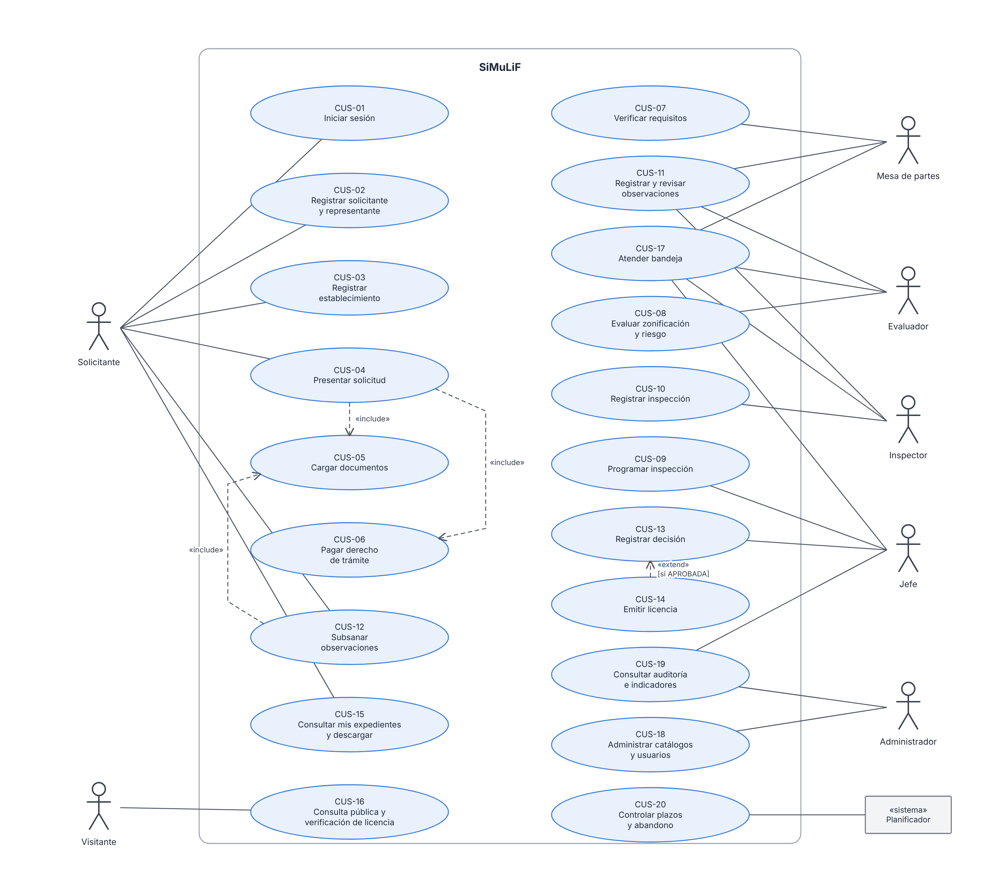
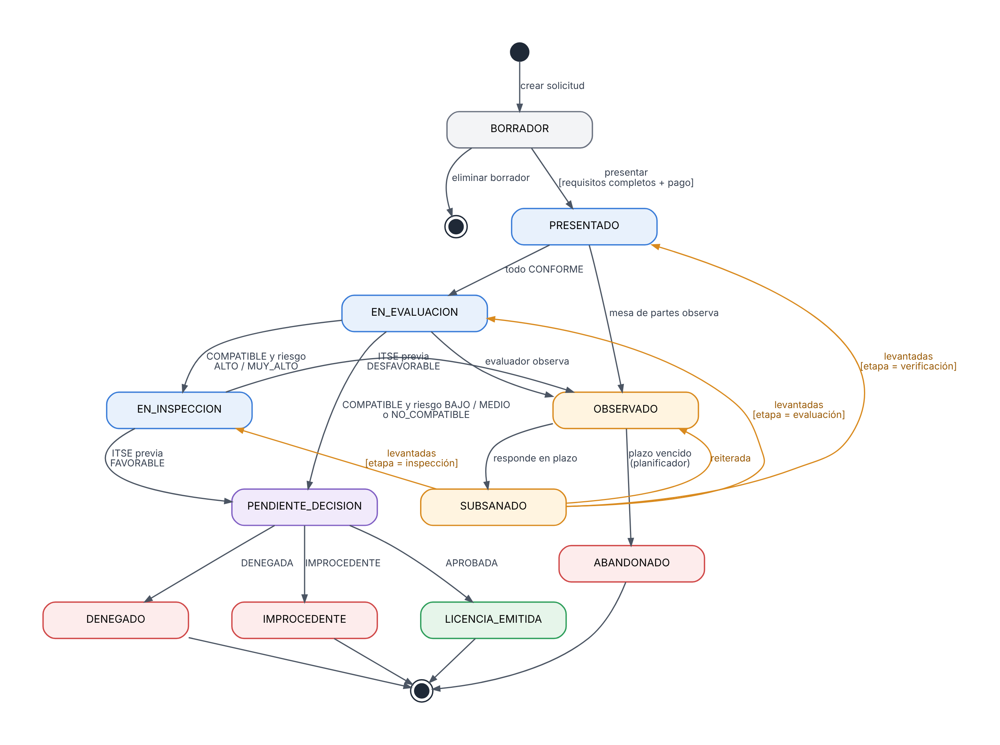

# 5. Diseño: casos de uso del sistema

| Proyecto | Curso | Entrega | Versión | Fecha |
|---|---|---|---|---|
| SiMuLiF, Sistema Municipal de Licencias de Funcionamiento (proyecto 4) | SW505 Proceso de Construcción de Software I, 2026-2 | Fase 1: análisis y diseño | 1.0 | 12/11/2026 |

## 1. Actores del sistema

| Actor | Rol en el sistema | Descripción |
|---|---|---|
| Solicitante | `SOLICITANTE` | Ciudadano o representante con cuenta |
| Visitante | (sin sesión) | Consulta pública y verificación de licencias |
| Mesa de partes | `MESA_PARTES` | Verifica requisitos |
| Evaluador | `EVALUADOR` | Evalúa zonificación y riesgo |
| Inspector | `INSPECTOR` | Registra inspecciones |
| Jefe | `JEFE` | Programa inspecciones, decide y emite |
| Administrador | `ADMIN` | Usuarios, catálogos y parámetros |
| Planificador | (sistema) | Tareas diarias: plazos, abandono, alertas |
| Servicios externos simulados | (sistema) | RENIEC, SUNAT, pasarela de pago, correo, zonificación |

## 2. Diagrama de casos de uso del sistema

*Figura: Diagrama de casos de uso del sistema (UML).*

> Todos los actores internos y el solicitante usan CUS-01 para autenticarse.

## 3. Máquina de estados del expediente

*Figura: Diagrama de estados del expediente.*

| Estado origen | Evento / condición | Estado destino |
|---|---|---|
| (inicio) | Crear solicitud | BORRADOR |
| BORRADOR | Presentar (requisitos completos + pago confirmado) | PRESENTADO |
| BORRADOR | Eliminar borrador | (fin) |
| PRESENTADO | Mesa de partes: todo CONFORME | EN_EVALUACION |
| PRESENTADO | Mesa de partes observa | OBSERVADO |
| EN_EVALUACION | COMPATIBLE y riesgo ALTO/MUY_ALTO | EN_INSPECCION |
| EN_EVALUACION | COMPATIBLE y riesgo BAJO/MEDIO | PENDIENTE_DECISION |
| EN_EVALUACION | NO_COMPATIBLE (propone denegar) | PENDIENTE_DECISION |
| EN_EVALUACION | Evaluador observa | OBSERVADO |
| EN_INSPECCION | ITSE previa FAVORABLE | PENDIENTE_DECISION |
| EN_INSPECCION | ITSE previa DESFAVORABLE | OBSERVADO |
| OBSERVADO | Solicitante responde todo en plazo | SUBSANADO |
| OBSERVADO | Plazo vencido (planificador) | ABANDONADO |
| SUBSANADO | Observaciones levantadas (etapa = verificación) | PRESENTADO |
| SUBSANADO | Observaciones levantadas (etapa = evaluación) | EN_EVALUACION |
| SUBSANADO | Observaciones levantadas (etapa = inspección) | EN_INSPECCION |
| SUBSANADO | Observación reiterada | OBSERVADO |
| PENDIENTE_DECISION | APROBADA (emite licencia) | LICENCIA_EMITIDA |
| PENDIENTE_DECISION | DENEGADA | DENEGADO |
| PENDIENTE_DECISION | IMPROCEDENTE | IMPROCEDENTE |

**Estados finales:** LICENCIA_EMITIDA, DENEGADO, IMPROCEDENTE, ABANDONADO.
**Implementación:** patrón **State** (cada estado decide qué transiciones permite) o una tabla de transiciones validada en un único servicio `MaquinaEstadosExpediente`. Cualquier transición no listada lanza `TransicionInvalidaError` (HTTP 409).
**Cómputo de plazos:** el plazo de evaluación corre desde PRESENTADO; se **suspende** mientras el expediente está en OBSERVADO/SUBSANADO y se reanuda al volver a su etapa (RN-06).

## 4. Especificaciones

Cada caso de uso se especifica en una tabla con actor, precondición, flujo básico, flujos alternativos, postcondición y trazabilidad.

### CUS-01 Iniciar sesión

| Campo | Detalle |
|---|---|
| **Actor** | Cualquier usuario registrado |
| **Precondición** | Cuenta activa. |
| **Flujo básico** | 1) Ingresa correo y contraseña. 2) El sistema verifica el hash. 3) Emite el JWT (access + refresh) con sus roles. 4) Redirige al panel de su rol. |
| **Flujos alternativos** | 2a) Credenciales inválidas: mensaje genérico y suma de intentos; al 5.° intento bloquea 15 minutos. 2b) Cuenta bloqueada o inactiva: mensaje. |
| **Postcondición** | Sesión iniciada; evento de auditoría LOGIN_OK o LOGIN_FAIL. |
| **Trazabilidad** | RF-T01, RF-T05, RNF-01 |

### CUS-02 Registrar solicitante y representante

| Campo | Detalle |
|---|---|
| **Actor** | Solicitante (autoregistro) |
| **Precondición** | Ninguna. |
| **Flujo básico** | 1) Elige tipo de persona. 2) Ingresa DNI o RUC. 3) El sistema consulta el adaptador RENIEC/SUNAT y precarga nombres o razón social. 4) Completa contacto y crea su contraseña. 5) Si es persona jurídica, registra uno o más representantes con datos del poder. 6) El sistema crea SOLICITANTE, USUARIO (rol SOLICITANTE) y REPRESENTANTE. |
| **Flujos alternativos** | 3a) Documento no encontrado o RUC no ACTIVO/HABIDO: no permite continuar. 3b) Documento ya registrado: informa y ofrece recuperar la cuenta. |
| **Postcondición** | Solicitante y cuenta creados. |
| **Trazabilidad** | RF-101 a RF-104, RN-01, RN-10 |

### CUS-03 Registrar establecimiento

| Campo | Detalle |
|---|---|
| **Actor** | Solicitante |
| **Precondición** | Sesión iniciada. |
| **Flujo básico** | 1) Ingresa nombre comercial, dirección, referencia y elige la zona/código catastral. 2) Elige el giro CIIU. 3) Ingresa área, aforo, pisos, sótano y patrimonio. 4) El sistema calcula el nivel de riesgo y lo muestra con la explicación. 5) Guarda. |
| **Flujos alternativos** | 3a) Valores fuera de rango: mensaje por campo. 2a) Giro inactivo: no se lista. |
| **Postcondición** | Establecimiento registrado con `nivel_riesgo_calculado`. |
| **Trazabilidad** | RF-105, RF-201 a RF-204, RN-02 |

### CUS-04 Presentar solicitud

| Campo | Detalle |
|---|---|
| **Actor** | Solicitante |
| **Precondición** | Establecimiento registrado. |
| **Flujo básico** | 1) Elige establecimiento y procedimiento (si es temporal, indica la fecha de fin). 2) El sistema verifica RN-03 y crea la SOLICITUD en BORRADOR con su lista de REQUISITO_SOLICITUD según RN-04. 3) El solicitante adjunta documentos (**include CUS-05**). 4) Paga el derecho (**include CUS-06**). 5) Acepta la declaración jurada. 6) El sistema valida la completitud (RF-401), asigna `codigo_expediente`, copia el nivel de riesgo, fija `tipo_itse`, calcula `fecha_limite_evaluacion` en días hábiles, cambia a PRESENTADO, genera el cargo PDF, registra el evento y notifica. |
| **Flujos alternativos** | 2a) Ya existe licencia vigente o trámite en curso para el giro: rechaza (409). 6a) Faltan requisitos: lista los faltantes y queda en BORRADOR. 6b) Pago no confirmado: queda en BORRADOR. |
| **Postcondición** | Expediente PRESENTADO. |
| **Trazabilidad** | RF-301 a RF-306, RF-401, RN-03, RN-04, RN-05, RN-06 |

### CUS-05 Cargar documentos

| Campo | Detalle |
|---|---|
| **Actor** | Solicitante (también Inspector para fotos) |
| **Precondición** | Solicitud en BORRADOR u OBSERVADO, o inspección en curso. |
| **Flujo básico** | 1) Elige el requisito. 2) Selecciona el archivo. 3) El sistema valida tipo y tamaño, calcula SHA-256, lo guarda en el almacenamiento de objetos y registra los metadatos en DOCUMENTO. 4) Marca el requisito como ADJUNTADO. |
| **Flujos alternativos** | 3a) Formato o tamaño inválido: rechaza (422). 3b) Falla del almacenamiento: no se registra nada (transacción) y se informa. |
| **Trazabilidad** | RF-303, RN-11, RNF-12 |

### CUS-06 Pagar derecho de trámite

| Campo | Detalle |
|---|---|
| **Actor** | Solicitante |
| **Precondición** | Solicitud en BORRADOR. |
| **Flujo básico** | 1) El sistema muestra el monto del procedimiento. 2) El solicitante "paga" en la pasarela simulada. 3) El adaptador devuelve el código de operación. 4) Se registra PAGO CONFIRMADO. |
| **Flujos alternativos** | 3a) Pago rechazado (la pasarela simulada rechaza tarjetas terminadas en 0000): PAGO RECHAZADO, puede reintentar. |
| **Trazabilidad** | RF-304, RN-05 |

### CUS-07 Verificar requisitos

| Campo | Detalle |
|---|---|
| **Actor** | Mesa de partes |
| **Precondición** | Expediente PRESENTADO. |
| **Flujo básico** | 1) Abre el expediente desde su bandeja. 2) Revisa cada documento (visor). 3) Marca cada requisito como CONFORME u OBSERVADO con comentario. 4) Confirma. 5) Si todos están CONFORME → EN_EVALUACION. |
| **Flujos alternativos** | 5a) Hay algún OBSERVADO → se ejecuta CUS-11 automáticamente con esas observaciones y el expediente pasa a OBSERVADO (etapa = VERIFICACION). 2a) Poder vencido: el sistema sugiere OBSERVADO. |
| **Trazabilidad** | RF-402, RF-403, RN-01, RN-07 |

### CUS-08 Evaluar zonificación y riesgo

| Campo | Detalle |
|---|---|
| **Actor** | Evaluador |
| **Precondición** | Expediente EN_EVALUACION. |
| **Flujo básico** | 1) El sistema consulta el adaptador de zonificación y muestra el resultado sugerido (COMPATIBLE/NO_COMPATIBLE/NO_REGISTRADO) y el nivel de riesgo. 2) El evaluador confirma o corrige con sustento; opcionalmente reclasifica el riesgo con sustento. 3) Guarda la EVALUACION_ZONIFICACION. 4) Transición: COMPATIBLE + ALTO/MUY_ALTO → EN_INSPECCION; COMPATIBLE + BAJO/MEDIO → PENDIENTE_DECISION; NO_COMPATIBLE → PENDIENTE_DECISION con propuesta de denegatoria. |
| **Flujos alternativos** | 2a) Falta información: registra una observación (CUS-11, etapa = EVALUACION). 1a) NO_REGISTRADO: el evaluador debe decidir manualmente con sustento. |
| **Trazabilidad** | RF-204, RF-501, RF-502, RN-02, RN-08 |

### CUS-09 Programar inspección

| Campo | Detalle |
|---|---|
| **Actor** | Jefe |
| **Precondición** | Expediente EN_INSPECCION (ITSE previa) o LICENCIA_EMITIDA con `tipo_itse = POSTERIOR`. |
| **Flujo básico** | 1) Elige inspector y fecha/hora. 2) El sistema valida disponibilidad. 3) Crea INSPECCION PROGRAMADA y notifica al solicitante y al inspector. |
| **Flujos alternativos** | 2a) Conflicto de horario o fecha pasada: rechaza. |
| **Trazabilidad** | RF-601, RN-02 |

### CUS-10 Registrar inspección

| Campo | Detalle |
|---|---|
| **Actor** | Inspector |
| **Precondición** | Inspección PROGRAMADA asignada a él. |
| **Flujo básico** | 1) El sistema carga la plantilla del checklist según giro y riesgo (NoSQL). 2) El inspector responde cada ítem (CUMPLE/NO_CUMPLE/NO_APLICA) y adjunta fotos (CUS-05). 3) Registra el resultado. 4) Si es previa: FAVORABLE → PENDIENTE_DECISION; DESFAVORABLE → observaciones (CUS-11, etapa = INSPECCION) y OBSERVADO. |
| **Flujos alternativos** | 4a) Si es posterior y DESFAVORABLE: alerta al jefe (RN-09); el estado no cambia. 1a) No existe plantilla: usa la plantilla genérica. |
| **Trazabilidad** | RF-602, RF-603, RN-09 |

### CUS-11 Registrar y revisar observaciones

| Campo | Detalle |
|---|---|
| **Actores** | Mesa de partes, Evaluador, Inspector |
| **Precondición** | El expediente está en una etapa a su cargo, o SUBSANADO. |
| **Flujo (registrar)** | 1) Escribe una o más observaciones (texto y requisito opcional). 2) El sistema fija `fecha_limite_subsanacion` = hoy + PLAZO_SUBSANACION días hábiles, guarda `etapa_observada`, suspende el plazo de evaluación, cambia a OBSERVADO y notifica. |
| **Flujo (revisar subsanación)** | 1) Abre el expediente SUBSANADO. 2) Marca cada observación LEVANTADA o REITERADA. 3) Todas levantadas → vuelve al estado de `etapa_observada`; alguna reiterada → OBSERVADO con nuevo plazo. |
| **Trazabilidad** | RF-701, RF-704, RN-07 |

### CUS-12 Subsanar observaciones

| Campo | Detalle |
|---|---|
| **Actor** | Solicitante |
| **Precondición** | Expediente OBSERVADO y dentro del plazo. |
| **Flujo básico** | 1) Ve las observaciones abiertas. 2) Responde cada una con comentario y documentos (include CUS-05). 3) Envía. 4) El sistema verifica que todas tengan respuesta y cambia a SUBSANADO; notifica al funcionario. |
| **Flujos alternativos** | 1a) Plazo vencido: no permite responder (el planificador lo pasará a ABANDONADO). |
| **Trazabilidad** | RF-702, RN-07 |

### CUS-13 Registrar decisión

| Campo | Detalle |
|---|---|
| **Actor** | Jefe |
| **Precondición** | Expediente PENDIENTE_DECISION; el jefe no inspeccionó este expediente. |
| **Flujo básico** | 1) Revisa el resumen (requisitos, evaluación, inspección, historial). 2) Elige APROBADA, DENEGADA o IMPROCEDENTE y escribe el sustento. 3) El sistema valida RN-08. 4) Registra la DECISION. 5) APROBADA → **extend CUS-14**; DENEGADA/IMPROCEDENTE → genera resolución PDF, cambia el estado y notifica. |
| **Flujos alternativos** | 3a) Intenta aprobar sin compatibilidad o sin ITSE previa favorable: bloquea (409). |
| **Trazabilidad** | RF-801, RF-803, RN-08, RN-15 |

### CUS-14 Emitir licencia

| Campo | Detalle |
|---|---|
| **Actor** | Jefe (disparado por CUS-13) |
| **Precondición** | Decisión APROBADA. |
| **Flujo básico** | 1) Genera `numero_licencia` correlativo del año y un `codigo_verificacion` aleatorio. 2) Genera el PDF con QR (URL pública de verificación) y marca de agua de documento simulado. 3) Lo guarda en el bucket `emitidos`. 4) Crea LICENCIA VIGENTE. 5) Estado → LICENCIA_EMITIDA. 6) Notifica. 7) Si `tipo_itse = POSTERIOR`, deja una tarea pendiente de programar ITSE posterior en la bandeja del jefe. |
| **Trazabilidad** | RF-802, RN-12, RNF-18 |

### CUS-15 Consultar mis expedientes y descargar documentos

| Campo | Detalle |
|---|---|
| **Actor** | Solicitante |
| **Precondición** | Sesión iniciada. |
| **Flujo básico** | 1) Lista sus expedientes con estado y fecha límite. 2) Abre uno y ve la línea de tiempo (eventos), las observaciones y los documentos emitidos. 3) Descarga con enlace firmado de 15 minutos. |
| **Trazabilidad** | RF-804, RF-901 |

### CUS-16 Consulta pública y verificación de licencia

| Campo | Detalle |
|---|---|
| **Actor** | Visitante |
| **Precondición** | Ninguna. |
| **Flujo A (estado)** | Ingresa código de expediente + número de documento → ve estado, etapa y fechas (documento enmascarado). |
| **Flujo B (licencia)** | Escanea el QR o ingresa el número → ve si la licencia existe y está VIGENTE, con nombre comercial, dirección y giro. |
| **Flujos alternativos** | Datos no coinciden → "No se encontró información" (sin revelar cuál dato falló). Rate limit por IP. |
| **Trazabilidad** | RF-902, RF-903, RNF-03 |

### CUS-17 Atender bandeja

| Campo | Detalle |
|---|---|
| **Actores** | Mesa de partes, Evaluador, Inspector, Jefe |
| **Precondición** | Sesión con rol interno. |
| **Flujo básico** | 1) El sistema lista los expedientes del estado que atiende su rol (MESA_PARTES: PRESENTADO y SUBSANADO de verificación; EVALUADOR: EN_EVALUACION y SUBSANADO de evaluación; INSPECTOR: sus inspecciones PROGRAMADAS; JEFE: EN_INSPECCION sin programar, PENDIENTE_DECISION, ITSE posteriores pendientes). 2) Filtra y ordena por fecha límite. 3) Abre el expediente para atenderlo. |
| **Trazabilidad** | RF-904 |

### CUS-18 Administrar catálogos y usuarios

| Campo | Detalle |
|---|---|
| **Actor** | Administrador. |
| **Flujo básico** | CRUD de procedimientos, requisitos y sus condiciones, giros CIIU, zonas, matriz de compatibilidad, umbrales de riesgo, parámetros de plazos, feriados, plantillas de inspección y usuarios internos con sus roles. |
| **Flujos alternativos** | No se puede eliminar un registro de catálogo en uso; solo desactivarlo. |
| **Trazabilidad** | RF-T07, RF-T08, RNF-15 |

### CUS-19 Consultar auditoría e indicadores

| Campo | Detalle |
|---|---|
| **Actores** | Jefe, Administrador. |
| **Flujo básico** | 1) Panel: expedientes por estado, tiempo promedio por etapa, licencias por mes y riesgo, expedientes por vencer y con silencio positivo. 2) Auditoría filtrable por fecha, usuario, acción y expediente. 3) Exportar a CSV (opcional). |
| **Trazabilidad** | RF-T05, RF-T09, RF-T10 |

### CUS-20 Controlar plazos y abandono

| Campo | Detalle |
|---|---|
| **Actor** | Planificador (tarea diaria a las 00:30) |
| **Precondición** | Ninguna. |
| **Flujo básico** | 1) OBSERVADO con `fecha_limite_subsanacion` vencida → ABANDONADO + evento + notificación. 2) Expedientes en evaluación con ≤ 1 día hábil restante → alerta al jefe. 3) Plazo legal vencido sin decisión → `silencio_positivo_aplicable = true` + alerta. |
| **Trazabilidad** | RF-703, RF-T06, RN-06, RN-07 |

## 5. Matriz de trazabilidad (resumen)

| CUS | RF principales | RN |
|---|---|---|
| CUS-01 | RF-T01, RF-T05 | — |
| CUS-02 | RF-101 a RF-104 | RN-01, RN-10 |
| CUS-03 | RF-105, RF-201 a RF-204 | RN-02 |
| CUS-04 | RF-301 a RF-306, RF-401 | RN-03 a RN-06 |
| CUS-05 | RF-303 | RN-11 |
| CUS-06 | RF-304 | RN-05 |
| CUS-07 | RF-402, RF-403 | RN-01, RN-07 |
| CUS-08 | RF-204, RF-501, RF-502 | RN-02, RN-08 |
| CUS-09 | RF-601 | RN-02 |
| CUS-10 | RF-602, RF-603 | RN-09 |
| CUS-11 | RF-701, RF-704 | RN-07 |
| CUS-12 | RF-702 | RN-07 |
| CUS-13 | RF-801, RF-803 | RN-08, RN-15 |
| CUS-14 | RF-802 | RN-12 |
| CUS-15 | RF-804, RF-901 | — |
| CUS-16 | RF-902, RF-903 | RN-12 |
| CUS-17 | RF-904 | — |
| CUS-18 | RF-T07, RF-T08 | — |
| CUS-19 | RF-T05, RF-T09, RF-T10 | — |
| CUS-20 | RF-703, RF-T06 | RN-06, RN-07 |
| Transversal | RF-T02, RF-T03, RF-T04 | RN-13, RN-14 |
