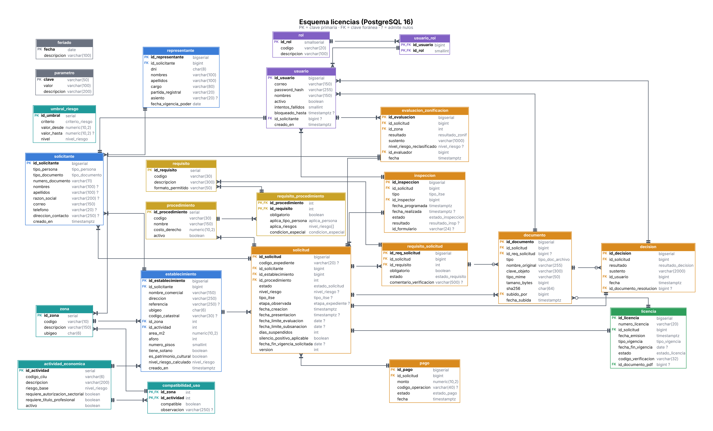
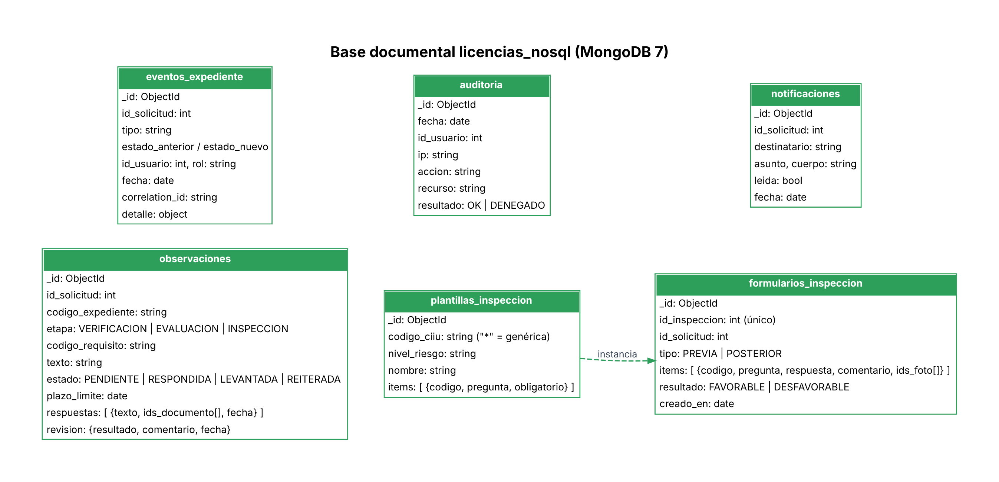

# 6. Modelo físico de datos

| Proyecto | Curso | Entrega | Versión | Fecha |
|---|---|---|---|---|
| SiMuLiF, Sistema Municipal de Licencias de Funcionamiento (proyecto 4) | SW505 Proceso de Construcción de Software I, 2026-2 | Fase 1: análisis y diseño | 1.0 | 12/11/2026 |

El modelo físico implementa el [modelo lógico](<4. Modelo lógico de datos.md>) en tres tecnologías:

| Tecnología | Motor | Base / bucket | Script |
|---|---|---|---|
| SQL | PostgreSQL 16 | BD `simulif`, esquema `licencias` | [`database/sql/01_schema.sql`](#anexo-a-script-del-esquema-01_schemasql), [`02_seed.sql`](#anexo-b-datos-semilla-02_seedsql) |
| NoSQL | MongoDB 7 | BD `licencias_nosql` | [`database/mongo/01_init.js`](#anexo-c-inicialización-de-mongodb-01_initjs) |
| Objetos | MinIO (compatible S3) | buckets `expedientes`, `inspecciones`, `emitidos` | Creados por el servicio `minio-init` de Docker Compose |

> Los scripts SQL fueron probados en PostgreSQL 16: crean 23 tablas con sus restricciones y cargan los datos semilla sin errores.

## 1. PostgreSQL



*Figura: Diagrama físico de la base de datos (PostgreSQL).*

### 1.1 Tipos enumerados
`tipo_persona`, `tipo_documento`, `nivel_riesgo` (BAJO, MEDIO, ALTO, MUY_ALTO), `tipo_itse` (PREVIA, POSTERIOR), `estado_solicitud` (11 estados de la [máquina de estados](<5. Diseño - Casos de uso del sistema.md#3-máquina-de-estados-del-expediente>)), `etapa_expediente`, `estado_requisito`, `tipo_doc_archivo`, `estado_pago`, `resultado_zonif`, `estado_inspeccion`, `resultado_insp`, `resultado_decision`, `tipo_vigencia`, `estado_licencia`, `aplica_persona`, `condicion_especial`, `criterio_riesgo`.

### 1.2 Tablas

| Tabla | PK | Columnas principales (tipo) | FK | Restricciones e índices |
|---|---|---|---|---|
| `rol` | id_rol SMALLSERIAL | codigo VARCHAR(20), descripcion | — | codigo UNIQUE |
| `solicitante` | id_solicitante BIGSERIAL | tipo_persona, tipo_documento, numero_documento VARCHAR(11), nombres, apellidos, razon_social, correo, telefono, direccion_contacto, creado_en TIMESTAMPTZ | — | numero_documento UNIQUE; CHECK: DNI 8 dígitos para natural, RUC 11 dígitos iniciando en 10/20 para jurídica |
| `usuario` | id_usuario BIGSERIAL | correo, password_hash, nombres, activo, intentos_fallidos, bloqueado_hasta, creado_en | id_solicitante → solicitante (único, opcional) | correo UNIQUE |
| `usuario_rol` | (id_usuario, id_rol) | — | usuario, rol | ON DELETE CASCADE |
| `representante` | id_representante BIGSERIAL | dni CHAR(8), nombres, apellidos, cargo, partida_registral, asiento, fecha_vigencia_poder DATE | solicitante | UNIQUE (id_solicitante, dni) |
| `actividad_economica` | id_actividad SERIAL | codigo_ciiu VARCHAR(6), descripcion, riesgo_base, requiere_autorizacion_sectorial, requiere_titulo_profesional, activo | — | codigo_ciiu UNIQUE |
| `zona` | id_zona SERIAL | codigo, descripcion, ubigeo CHAR(6) | — | codigo UNIQUE |
| `compatibilidad_uso` | (id_zona, id_actividad) | compatible BOOLEAN, observacion | zona, actividad | — |
| `umbral_riesgo` | id_umbral SERIAL | criterio (AREA/AFORO), valor_desde, valor_hasta NUMERIC(10,2), nivel | — | CHECK hasta > desde |
| `procedimiento` | id_procedimiento SERIAL | codigo, nombre, costo_derecho NUMERIC(10,2), activo | — | codigo UNIQUE |
| `requisito` | id_requisito SERIAL | codigo, descripcion, formato_permitido | — | codigo UNIQUE |
| `requisito_procedimiento` | (id_procedimiento, id_requisito) | obligatorio, aplica_tipo_persona, aplica_riesgos nivel_riesgo[], condicion_especial | procedimiento, requisito | — |
| `parametro` | clave VARCHAR(50) | valor, descripcion | — | — |
| `feriado` | fecha DATE | descripcion | — | — |
| `establecimiento` | id_establecimiento BIGSERIAL | nombre_comercial, direccion, referencia, ubigeo, codigo_catastral, area_m2 NUMERIC(10,2), aforo INT, numero_pisos SMALLINT, tiene_sotano, es_patrimonio_cultural, nivel_riesgo_calculado, creado_en | solicitante, zona, actividad | CHECK 0 < área ≤ 50 000, aforo ≥ 1, pisos ≥ 1 |
| `solicitud` | id_solicitud BIGSERIAL | codigo_expediente VARCHAR(20), estado, nivel_riesgo, tipo_itse, etapa_observada, fecha_creacion, fecha_presentacion, fecha_limite_evaluacion, fecha_limite_subsanacion, dias_suspendidos, silencio_positivo_aplicable, fecha_fin_vigencia_solicitada, version | solicitante, establecimiento, procedimiento | codigo_expediente UNIQUE; CHECK si no es BORRADOR tiene código, fecha, riesgo y tipo de ITSE; **índice único parcial**: una solicitud en trámite por establecimiento (RN-03); índice (estado, fecha_limite_evaluacion) |
| `requisito_solicitud` | id_req_solicitud BIGSERIAL | obligatorio, estado, comentario_verificacion | solicitud, requisito | UNIQUE (id_solicitud, id_requisito) |
| `documento` | id_documento BIGSERIAL | tipo, nombre_original, clave_objeto, tipo_mime, tamano_bytes, sha256 CHAR(64), fecha_subida | solicitud, requisito_solicitud, usuario (subido_por) | clave_objeto UNIQUE; CHECK MIME (pdf/jpeg/png) y tamaño ≤ 10 MB |
| `pago` | id_pago BIGSERIAL | monto, codigo_operacion, estado, fecha | solicitud | codigo_operacion UNIQUE |
| `evaluacion_zonificacion` | id_evaluacion BIGSERIAL | resultado, sustento, nivel_riesgo_reclasificado, fecha | solicitud (UNIQUE), zona, usuario | — |
| `inspeccion` | id_inspeccion BIGSERIAL | tipo, fecha_programada, fecha_realizada, estado, resultado, id_formulario VARCHAR(24) | solicitud, usuario (inspector) | CHECK REALIZADA ⇒ resultado y fecha; **índice único parcial** (inspector, fecha) para inspecciones PROGRAMADAS |
| `decision` | id_decision BIGSERIAL | resultado, sustento, fecha | solicitud (UNIQUE), usuario, documento (resolución) | — |
| `licencia` | id_licencia BIGSERIAL | numero_licencia, fecha_emision, tipo_vigencia, fecha_fin_vigencia, estado, codigo_verificacion | solicitud (UNIQUE), documento (PDF) | numero_licencia y codigo_verificacion UNIQUE; CHECK TEMPORAL ⇔ fecha fin |

Secuencias: `seq_expediente` y `seq_licencia` para los correlativos `LF-AAAA-NNNNNN` y `LIC-AAAA-NNNNNN`.

### 1.3 Decisiones físicas

| Decisión | Detalle |
|---|---|
| **Bloqueo optimista** | `solicitud.version` evita que dos funcionarios cambien el estado a la vez (si la versión no coincide, se devuelve 409). |
| **Reglas en la BD además de en el código** | Unicidad de trámite (RN-03), formato de documentos (RN-11), coherencia de licencia temporal. La BD es la última línea de defensa. |
| **Contraseñas** | Bcrypt (`$2a$`, costo 12). La semilla usa `pgcrypto` para generar los hashes de los usuarios de prueba. |
| **Migraciones** | En la fase 2, el esquema se versiona con **Alembic**; `01_schema.sql` queda como referencia del diseño y como base de la primera migración. |

### 1.4 Usuarios de prueba (semilla)
Todos con contraseña `Simulif2026!` (cambiarla fuera del entorno académico): `admin@`, `mesapartes@`, `evaluador@`, `inspector@`, `inspector2@` y `jefe@simulif.pe`.

## 2. MongoDB (`licencias_nosql`)



*Figura: Diagrama de colecciones de MongoDB.*

| Colección | Validación | Índices | Documento de ejemplo |
|---|---|---|---|
| `observaciones` | `$jsonSchema` (etapa, estado, plazo, respuestas) | (id_solicitud, estado) | ver abajo |
| `plantillas_inspeccion` | — | (codigo_ciiu, nivel_riesgo) único; `codigo_ciiu: "*"` = plantilla genérica | ítems por giro y riesgo |
| `formularios_inspeccion` | `$jsonSchema` (respuesta CUMPLE/NO_CUMPLE/NO_APLICA) | id_inspeccion único | checklist llenado |
| `eventos_expediente` | — (solo inserción) | (id_solicitud, fecha), (tipo, fecha) | bitácora |
| `auditoria` | — (solo inserción) | fecha, (id_usuario, fecha), (accion, fecha) | accesos |
| `notificaciones` | — | (id_solicitud, fecha), (destinatario, leida) | correos simulados |

Ejemplos:
```json
// observaciones
{ "id_solicitud": 123, "codigo_expediente": "LF-2026-000123", "etapa": "VERIFICACION",
  "codigo_requisito": "VIGENCIA_PODER", "texto": "La vigencia de poder tiene más de 30 días.",
  "estado": "RESPONDIDA", "plazo_limite": {"$date": "2026-11-17T23:59:59-05:00"},
  "creado_por": 2, "creado_en": {"$date": "2026-11-13T10:00:00-05:00"},
  "respuestas": [ { "texto": "Adjunto vigencia actualizada", "ids_documento": [88],
                    "fecha": {"$date": "2026-11-14T09:12:00-05:00"} } ],
  "revision": null }

// eventos_expediente
{ "id_solicitud": 123, "codigo_expediente": "LF-2026-000123", "tipo": "CAMBIO_ESTADO",
  "estado_anterior": "PRESENTADO", "estado_nuevo": "OBSERVADO",
  "id_usuario": 2, "rol": "MESA_PARTES", "fecha": {"$date": "2026-11-13T10:00:00-05:00"},
  "correlation_id": "c7f1...", "detalle": { "observaciones": 1, "etapa": "VERIFICACION" } }

// formularios_inspeccion
{ "id_inspeccion": 45, "id_solicitud": 130, "tipo": "PREVIA", "plantilla": "Bares y discotecas",
  "items": [ { "codigo": "EXT-01", "pregunta": "¿Extintores operativos?", "respuesta": "CUMPLE" },
             { "codigo": "DET-01", "pregunta": "¿Detección de incendios?", "respuesta": "NO_CUMPLE",
               "comentario": "Sin detectores en el segundo piso", "ids_foto": [301] } ],
  "resultado": "DESFAVORABLE", "creado_en": {"$date": "2026-11-20T15:30:00-05:00"} }

// auditoria
{ "fecha": {"$date": "2026-11-13T09:00:00-05:00"}, "id_usuario": 6, "ip": "10.0.0.5",
  "accion": "DESCARGA_DOCUMENTO", "recurso": "documento/88", "resultado": "OK", "correlation_id": "a1b2..." }
```

**Por qué NoSQL aquí:** las observaciones tienen un número variable de rondas de respuesta; los checklists cambian por giro y riesgo sin migrar el esquema; la bitácora y la auditoría solo crecen y se consultan por expediente o por fecha.

## 3. Almacenamiento de objetos (MinIO)

| Bucket | Contenido | Clave | Acceso |
|---|---|---|---|
| `expedientes` | Documentos de requisitos y subsanaciones | `{codigo_expediente}/{tipo}/{uuid}.{ext}` (en BORRADOR: `borrador-{id_solicitud}/...`) | Privado; descarga solo con URL firmada de 15 min |
| `inspecciones` | Fotos y evidencias | `{codigo_expediente}/insp-{id_inspeccion}/{uuid}.{ext}` | Privado |
| `emitidos` | Cargos, licencias y resoluciones PDF | `{codigo_expediente}/{CARGO\|LICENCIA\|RESOLUCION}-{numero}.pdf` | Privado; la verificación pública solo muestra datos, no el PDF |

Flujo de carga: el API recibe el archivo → valida tipo real (magic bytes) y tamaño → calcula SHA-256 → sube a MinIO → registra `documento` en PostgreSQL. Si falla el registro, se borra el objeto (compensación).

## 4. Respaldo
`pg_dump -Fc simulif`, `mongodump --db licencias_nosql` y `mc mirror` de los buckets. El procedimiento completo se detalla en la guía de despliegue y operaciones (fase 2).

## Anexo A. Script del esquema (01_schema.sql)

Archivo `database/sql/01_schema.sql` del repositorio.

```sql
-- =====================================================================
-- SiMuLiF - Modelo físico relacional (PostgreSQL 16)
-- Esquema: licencias
-- Ver docs/06_modelo_fisico_datos.md
-- =====================================================================
CREATE SCHEMA IF NOT EXISTS licencias;
SET search_path TO licencias;

-- ---------- Tipos enumerados ----------
CREATE TYPE tipo_persona      AS ENUM ('NATURAL', 'JURIDICA');
CREATE TYPE tipo_documento    AS ENUM ('DNI', 'RUC');
CREATE TYPE nivel_riesgo      AS ENUM ('BAJO', 'MEDIO', 'ALTO', 'MUY_ALTO');
CREATE TYPE tipo_itse         AS ENUM ('PREVIA', 'POSTERIOR');
CREATE TYPE estado_solicitud  AS ENUM (
  'BORRADOR', 'PRESENTADO', 'EN_EVALUACION', 'EN_INSPECCION', 'PENDIENTE_DECISION',
  'OBSERVADO', 'SUBSANADO', 'LICENCIA_EMITIDA', 'DENEGADO', 'IMPROCEDENTE', 'ABANDONADO');
CREATE TYPE etapa_expediente  AS ENUM ('VERIFICACION', 'EVALUACION', 'INSPECCION');
CREATE TYPE estado_requisito  AS ENUM ('PENDIENTE', 'ADJUNTADO', 'CONFORME', 'OBSERVADO');
CREATE TYPE tipo_doc_archivo  AS ENUM ('REQUISITO', 'SUBSANACION', 'FOTO_INSPECCION', 'CARGO', 'LICENCIA', 'RESOLUCION');
CREATE TYPE estado_pago       AS ENUM ('PENDIENTE', 'CONFIRMADO', 'RECHAZADO');
CREATE TYPE resultado_zonif   AS ENUM ('COMPATIBLE', 'NO_COMPATIBLE', 'NO_REGISTRADO');
CREATE TYPE estado_inspeccion AS ENUM ('PROGRAMADA', 'REALIZADA', 'CANCELADA');
CREATE TYPE resultado_insp    AS ENUM ('FAVORABLE', 'DESFAVORABLE');
CREATE TYPE resultado_decision AS ENUM ('APROBADA', 'DENEGADA', 'IMPROCEDENTE');
CREATE TYPE tipo_vigencia     AS ENUM ('INDETERMINADA', 'TEMPORAL');
CREATE TYPE estado_licencia   AS ENUM ('VIGENTE', 'SUSPENDIDA', 'REVOCADA', 'VENCIDA');
CREATE TYPE aplica_persona    AS ENUM ('NATURAL', 'JURIDICA', 'AMBAS');
CREATE TYPE condicion_especial AS ENUM ('NINGUNA', 'PATRIMONIO', 'AUT_SECTORIAL', 'TITULO_PROF');
CREATE TYPE criterio_riesgo   AS ENUM ('AREA', 'AFORO');

-- ---------- Seguridad ----------
CREATE TABLE rol (
  id_rol      SMALLSERIAL PRIMARY KEY,
  codigo      VARCHAR(20) NOT NULL UNIQUE,
  descripcion VARCHAR(100) NOT NULL
);

CREATE TABLE solicitante (
  id_solicitante   BIGSERIAL PRIMARY KEY,
  tipo_persona     tipo_persona   NOT NULL,
  tipo_documento   tipo_documento NOT NULL,
  numero_documento VARCHAR(11)    NOT NULL UNIQUE,
  nombres          VARCHAR(100),
  apellidos        VARCHAR(100),
  razon_social     VARCHAR(200),
  correo           VARCHAR(150) NOT NULL,
  telefono         VARCHAR(20),
  direccion_contacto VARCHAR(250),
  creado_en        TIMESTAMPTZ NOT NULL DEFAULT now(),
  CONSTRAINT ck_doc_por_tipo CHECK (
    (tipo_persona = 'NATURAL'  AND tipo_documento = 'DNI' AND numero_documento ~ '^[0-9]{8}$'  AND nombres IS NOT NULL) OR
    (tipo_persona = 'JURIDICA' AND tipo_documento = 'RUC' AND numero_documento ~ '^(10|20)[0-9]{9}$' AND razon_social IS NOT NULL))
);

CREATE TABLE usuario (
  id_usuario        BIGSERIAL PRIMARY KEY,
  correo            VARCHAR(150) NOT NULL UNIQUE,
  password_hash     VARCHAR(255) NOT NULL,
  nombres           VARCHAR(150) NOT NULL,
  activo            BOOLEAN NOT NULL DEFAULT TRUE,
  intentos_fallidos SMALLINT NOT NULL DEFAULT 0,
  bloqueado_hasta   TIMESTAMPTZ,
  id_solicitante    BIGINT UNIQUE REFERENCES solicitante(id_solicitante),
  creado_en         TIMESTAMPTZ NOT NULL DEFAULT now()
);

CREATE TABLE usuario_rol (
  id_usuario BIGINT   NOT NULL REFERENCES usuario(id_usuario) ON DELETE CASCADE,
  id_rol     SMALLINT NOT NULL REFERENCES rol(id_rol),
  PRIMARY KEY (id_usuario, id_rol)
);

CREATE TABLE representante (
  id_representante   BIGSERIAL PRIMARY KEY,
  id_solicitante     BIGINT NOT NULL REFERENCES solicitante(id_solicitante) ON DELETE CASCADE,
  dni                CHAR(8) NOT NULL CHECK (dni ~ '^[0-9]{8}$'),
  nombres            VARCHAR(100) NOT NULL,
  apellidos          VARCHAR(100) NOT NULL,
  cargo              VARCHAR(80)  NOT NULL,
  partida_registral  VARCHAR(20)  NOT NULL,
  asiento            VARCHAR(20),
  fecha_vigencia_poder DATE NOT NULL,
  UNIQUE (id_solicitante, dni)
);

-- ---------- Catálogos ----------
CREATE TABLE actividad_economica (
  id_actividad   SERIAL PRIMARY KEY,
  codigo_ciiu    VARCHAR(6)   NOT NULL UNIQUE,
  descripcion    VARCHAR(200) NOT NULL,
  riesgo_base    nivel_riesgo NOT NULL,
  requiere_autorizacion_sectorial BOOLEAN NOT NULL DEFAULT FALSE,
  requiere_titulo_profesional     BOOLEAN NOT NULL DEFAULT FALSE,
  activo         BOOLEAN NOT NULL DEFAULT TRUE
);

CREATE TABLE zona (
  id_zona     SERIAL PRIMARY KEY,
  codigo      VARCHAR(10)  NOT NULL UNIQUE,
  descripcion VARCHAR(150) NOT NULL,
  ubigeo      CHAR(6)      NOT NULL
);

CREATE TABLE compatibilidad_uso (
  id_zona      INT NOT NULL REFERENCES zona(id_zona),
  id_actividad INT NOT NULL REFERENCES actividad_economica(id_actividad),
  compatible   BOOLEAN NOT NULL,
  observacion  VARCHAR(250),
  PRIMARY KEY (id_zona, id_actividad)
);

CREATE TABLE umbral_riesgo (
  id_umbral    SERIAL PRIMARY KEY,
  criterio     criterio_riesgo NOT NULL,
  valor_desde  NUMERIC(10,2) NOT NULL,
  valor_hasta  NUMERIC(10,2),               -- NULL = sin tope
  nivel        nivel_riesgo NOT NULL,
  CHECK (valor_hasta IS NULL OR valor_hasta > valor_desde)
);

CREATE TABLE procedimiento (
  id_procedimiento SERIAL PRIMARY KEY,
  codigo           VARCHAR(30)  NOT NULL UNIQUE,
  nombre           VARCHAR(150) NOT NULL,
  costo_derecho    NUMERIC(10,2) NOT NULL CHECK (costo_derecho >= 0),
  activo           BOOLEAN NOT NULL DEFAULT TRUE
);

CREATE TABLE requisito (
  id_requisito      SERIAL PRIMARY KEY,
  codigo            VARCHAR(30)  NOT NULL UNIQUE,
  descripcion       VARCHAR(300) NOT NULL,
  formato_permitido VARCHAR(50)  NOT NULL DEFAULT 'PDF,JPG,PNG'
);

CREATE TABLE requisito_procedimiento (
  id_procedimiento   INT NOT NULL REFERENCES procedimiento(id_procedimiento),
  id_requisito       INT NOT NULL REFERENCES requisito(id_requisito),
  obligatorio        BOOLEAN NOT NULL DEFAULT TRUE,
  aplica_tipo_persona aplica_persona NOT NULL DEFAULT 'AMBAS',
  aplica_riesgos     nivel_riesgo[] NOT NULL DEFAULT ARRAY['BAJO','MEDIO','ALTO','MUY_ALTO']::nivel_riesgo[],
  condicion_especial condicion_especial NOT NULL DEFAULT 'NINGUNA',
  PRIMARY KEY (id_procedimiento, id_requisito)
);

CREATE TABLE parametro (
  clave       VARCHAR(50) PRIMARY KEY,
  valor       VARCHAR(100) NOT NULL,
  descripcion VARCHAR(200) NOT NULL
);

CREATE TABLE feriado (
  fecha       DATE PRIMARY KEY,
  descripcion VARCHAR(100) NOT NULL
);

-- ---------- Establecimiento ----------
CREATE TABLE establecimiento (
  id_establecimiento BIGSERIAL PRIMARY KEY,
  id_solicitante     BIGINT NOT NULL REFERENCES solicitante(id_solicitante),
  nombre_comercial   VARCHAR(150) NOT NULL,
  direccion          VARCHAR(250) NOT NULL,
  referencia         VARCHAR(250),
  ubigeo             CHAR(6) NOT NULL,
  codigo_catastral   VARCHAR(30),
  id_zona            INT NOT NULL REFERENCES zona(id_zona),
  id_actividad       INT NOT NULL REFERENCES actividad_economica(id_actividad),
  area_m2            NUMERIC(10,2) NOT NULL CHECK (area_m2 > 0 AND area_m2 <= 50000),
  aforo              INT NOT NULL CHECK (aforo >= 1),
  numero_pisos       SMALLINT NOT NULL CHECK (numero_pisos >= 1),
  tiene_sotano       BOOLEAN NOT NULL DEFAULT FALSE,
  es_patrimonio_cultural BOOLEAN NOT NULL DEFAULT FALSE,
  nivel_riesgo_calculado nivel_riesgo NOT NULL,
  creado_en          TIMESTAMPTZ NOT NULL DEFAULT now()
);

-- ---------- Expediente ----------
CREATE SEQUENCE seq_expediente;
CREATE SEQUENCE seq_licencia;

CREATE TABLE solicitud (
  id_solicitud        BIGSERIAL PRIMARY KEY,
  codigo_expediente   VARCHAR(20) UNIQUE,                -- LF-AAAA-NNNNNN, se asigna al presentar
  id_solicitante      BIGINT NOT NULL REFERENCES solicitante(id_solicitante),
  id_establecimiento  BIGINT NOT NULL REFERENCES establecimiento(id_establecimiento),
  id_procedimiento    INT    NOT NULL REFERENCES procedimiento(id_procedimiento),
  estado              estado_solicitud NOT NULL DEFAULT 'BORRADOR',
  nivel_riesgo        nivel_riesgo,
  tipo_itse           tipo_itse,
  etapa_observada     etapa_expediente,
  fecha_creacion      TIMESTAMPTZ NOT NULL DEFAULT now(),
  fecha_presentacion  TIMESTAMPTZ,
  fecha_limite_evaluacion  DATE,
  fecha_limite_subsanacion DATE,
  dias_suspendidos    INT NOT NULL DEFAULT 0,
  silencio_positivo_aplicable BOOLEAN NOT NULL DEFAULT FALSE,
  fecha_fin_vigencia_solicitada DATE,                    -- solo licencia temporal
  version             INT NOT NULL DEFAULT 0,            -- bloqueo optimista
  CONSTRAINT ck_presentada CHECK (estado = 'BORRADOR' OR
    (codigo_expediente IS NOT NULL AND fecha_presentacion IS NOT NULL AND nivel_riesgo IS NOT NULL AND tipo_itse IS NOT NULL))
);
-- RN-03: una sola solicitud en trámite por establecimiento
CREATE UNIQUE INDEX ux_solicitud_en_tramite ON solicitud(id_establecimiento)
  WHERE estado NOT IN ('LICENCIA_EMITIDA','DENEGADO','IMPROCEDENTE','ABANDONADO');
CREATE INDEX ix_solicitud_estado_fecha ON solicitud(estado, fecha_limite_evaluacion);
CREATE INDEX ix_solicitud_solicitante  ON solicitud(id_solicitante);

CREATE TABLE requisito_solicitud (
  id_req_solicitud BIGSERIAL PRIMARY KEY,
  id_solicitud     BIGINT NOT NULL REFERENCES solicitud(id_solicitud) ON DELETE CASCADE,
  id_requisito     INT    NOT NULL REFERENCES requisito(id_requisito),
  obligatorio      BOOLEAN NOT NULL,
  estado           estado_requisito NOT NULL DEFAULT 'PENDIENTE',
  comentario_verificacion VARCHAR(500),
  UNIQUE (id_solicitud, id_requisito)
);

CREATE TABLE documento (
  id_documento     BIGSERIAL PRIMARY KEY,
  id_solicitud     BIGINT NOT NULL REFERENCES solicitud(id_solicitud) ON DELETE CASCADE,
  id_req_solicitud BIGINT REFERENCES requisito_solicitud(id_req_solicitud),
  tipo             tipo_doc_archivo NOT NULL,
  nombre_original  VARCHAR(255) NOT NULL,
  clave_objeto     VARCHAR(300) NOT NULL UNIQUE,
  tipo_mime        VARCHAR(50)  NOT NULL CHECK (tipo_mime IN ('application/pdf','image/jpeg','image/png')),
  tamano_bytes     BIGINT NOT NULL CHECK (tamano_bytes > 0 AND tamano_bytes <= 10485760),
  sha256           CHAR(64) NOT NULL,
  subido_por       BIGINT NOT NULL REFERENCES usuario(id_usuario),
  fecha_subida     TIMESTAMPTZ NOT NULL DEFAULT now()
);
CREATE INDEX ix_documento_solicitud ON documento(id_solicitud);

CREATE TABLE pago (
  id_pago          BIGSERIAL PRIMARY KEY,
  id_solicitud     BIGINT NOT NULL REFERENCES solicitud(id_solicitud),
  monto            NUMERIC(10,2) NOT NULL CHECK (monto >= 0),
  codigo_operacion VARCHAR(40) UNIQUE,
  estado           estado_pago NOT NULL DEFAULT 'PENDIENTE',
  fecha            TIMESTAMPTZ NOT NULL DEFAULT now()
);
CREATE INDEX ix_pago_solicitud ON pago(id_solicitud);

CREATE TABLE evaluacion_zonificacion (
  id_evaluacion   BIGSERIAL PRIMARY KEY,
  id_solicitud    BIGINT NOT NULL UNIQUE REFERENCES solicitud(id_solicitud),
  id_zona         INT NOT NULL REFERENCES zona(id_zona),
  resultado       resultado_zonif NOT NULL,
  sustento        VARCHAR(1000) NOT NULL,
  nivel_riesgo_reclasificado nivel_riesgo,
  id_evaluador    BIGINT NOT NULL REFERENCES usuario(id_usuario),
  fecha           TIMESTAMPTZ NOT NULL DEFAULT now()
);

CREATE TABLE inspeccion (
  id_inspeccion    BIGSERIAL PRIMARY KEY,
  id_solicitud     BIGINT NOT NULL REFERENCES solicitud(id_solicitud),
  tipo             tipo_itse NOT NULL,
  id_inspector     BIGINT NOT NULL REFERENCES usuario(id_usuario),
  fecha_programada TIMESTAMPTZ NOT NULL,
  fecha_realizada  TIMESTAMPTZ,
  estado           estado_inspeccion NOT NULL DEFAULT 'PROGRAMADA',
  resultado        resultado_insp,
  id_formulario    VARCHAR(24),                         -- ObjectId en MongoDB
  CHECK (estado <> 'REALIZADA' OR (resultado IS NOT NULL AND fecha_realizada IS NOT NULL))
);
CREATE UNIQUE INDEX ux_inspector_horario ON inspeccion(id_inspector, fecha_programada) WHERE estado = 'PROGRAMADA';
CREATE INDEX ix_inspeccion_solicitud ON inspeccion(id_solicitud);

CREATE TABLE decision (
  id_decision    BIGSERIAL PRIMARY KEY,
  id_solicitud   BIGINT NOT NULL UNIQUE REFERENCES solicitud(id_solicitud),
  resultado      resultado_decision NOT NULL,
  sustento       VARCHAR(2000) NOT NULL,
  id_usuario     BIGINT NOT NULL REFERENCES usuario(id_usuario),
  fecha          TIMESTAMPTZ NOT NULL DEFAULT now(),
  id_documento_resolucion BIGINT REFERENCES documento(id_documento)
);

CREATE TABLE licencia (
  id_licencia         BIGSERIAL PRIMARY KEY,
  numero_licencia     VARCHAR(20) NOT NULL UNIQUE,     -- LIC-AAAA-NNNNNN
  id_solicitud        BIGINT NOT NULL UNIQUE REFERENCES solicitud(id_solicitud),
  fecha_emision       TIMESTAMPTZ NOT NULL DEFAULT now(),
  tipo_vigencia       tipo_vigencia NOT NULL,
  fecha_fin_vigencia  DATE,
  estado              estado_licencia NOT NULL DEFAULT 'VIGENTE',
  codigo_verificacion VARCHAR(32) NOT NULL UNIQUE,
  id_documento_pdf    BIGINT REFERENCES documento(id_documento),
  CHECK ((tipo_vigencia = 'TEMPORAL') = (fecha_fin_vigencia IS NOT NULL))
);
```

## Anexo B. Datos semilla (02_seed.sql)

Archivo `database/sql/02_seed.sql` del repositorio.

```sql
-- =====================================================================
-- SiMuLiF - Datos semilla (referenciales / ficticios)
-- Los plazos, montos y umbrales son valores de ejemplo: verificar con el
-- TUO de la Ley 28976, el D.S. 002-2018-PCM y el TUPA municipal.
-- =====================================================================
SET search_path TO licencias;
CREATE EXTENSION IF NOT EXISTS pgcrypto;

-- ---------- Roles ----------
INSERT INTO rol (codigo, descripcion) VALUES
 ('SOLICITANTE', 'Ciudadano o representante que tramita licencias'),
 ('MESA_PARTES', 'Verificación de requisitos'),
 ('EVALUADOR',   'Evaluación de zonificación y compatibilidad de uso'),
 ('INSPECTOR',   'Inspector técnico de seguridad en edificaciones'),
 ('JEFE',        'Jefe de la Subgerencia de Licencias'),
 ('ADMIN',       'Administrador del sistema');

-- ---------- Usuarios internos de prueba (contraseña: Simulif2026!) ----------
INSERT INTO usuario (correo, password_hash, nombres) VALUES
 ('admin@simulif.pe',      crypt('Simulif2026!', gen_salt('bf', 12)), 'Administrador General'),
 ('mesapartes@simulif.pe', crypt('Simulif2026!', gen_salt('bf', 12)), 'María Mesa de Partes'),
 ('evaluador@simulif.pe',  crypt('Simulif2026!', gen_salt('bf', 12)), 'Elena Evaluadora'),
 ('inspector@simulif.pe',  crypt('Simulif2026!', gen_salt('bf', 12)), 'Iván Inspector'),
 ('inspector2@simulif.pe', crypt('Simulif2026!', gen_salt('bf', 12)), 'Inés Inspectora'),
 ('jefe@simulif.pe',       crypt('Simulif2026!', gen_salt('bf', 12)), 'Jorge Jefe de Licencias');

INSERT INTO usuario_rol (id_usuario, id_rol)
SELECT u.id_usuario, r.id_rol FROM usuario u JOIN rol r ON
  (u.correo = 'admin@simulif.pe'      AND r.codigo = 'ADMIN') OR
  (u.correo = 'mesapartes@simulif.pe' AND r.codigo = 'MESA_PARTES') OR
  (u.correo = 'evaluador@simulif.pe'  AND r.codigo = 'EVALUADOR') OR
  (u.correo IN ('inspector@simulif.pe','inspector2@simulif.pe') AND r.codigo = 'INSPECTOR') OR
  (u.correo = 'jefe@simulif.pe'       AND r.codigo = 'JEFE');

-- ---------- Parámetros ----------
INSERT INTO parametro (clave, valor, descripcion) VALUES
 ('UBIGEO_MUNICIPALIDAD',      '150131', 'Distrito de la municipalidad (ficticio: San Isidro)'),
 ('PLAZO_EVAL_BAJO_MEDIO',     '4',  'Días hábiles máximos de evaluación para riesgo bajo/medio (verificar TUO)'),
 ('PLAZO_EVAL_ALTO_MUY_ALTO',  '10', 'Días hábiles máximos de evaluación para riesgo alto/muy alto (verificar TUO)'),
 ('PLAZO_SUBSANACION',         '2',  'Días hábiles para subsanar observaciones (verificar TUO LPAG)'),
 ('MAX_TAMANO_ARCHIVO_MB',     '10', 'Tamaño máximo por archivo'),
 ('INTENTOS_LOGIN_MAX',        '5',  'Intentos fallidos antes de bloquear'),
 ('MINUTOS_BLOQUEO_LOGIN',     '15', 'Minutos de bloqueo de cuenta'),
 ('MINUTOS_URL_FIRMADA',       '15', 'Vigencia de enlaces de descarga');

-- ---------- Feriados 2026 (Perú, referenciales) ----------
INSERT INTO feriado (fecha, descripcion) VALUES
 ('2026-01-01','Año Nuevo'), ('2026-04-02','Jueves Santo'), ('2026-04-03','Viernes Santo'),
 ('2026-05-01','Día del Trabajo'), ('2026-06-07','Batalla de Arica y Día de la Bandera'),
 ('2026-06-29','San Pedro y San Pablo'), ('2026-07-23','Día de la Fuerza Aérea'),
 ('2026-07-28','Fiestas Patrias'), ('2026-07-29','Fiestas Patrias'),
 ('2026-08-06','Batalla de Junín'), ('2026-08-30','Santa Rosa de Lima'),
 ('2026-10-08','Combate de Angamos'), ('2026-11-01','Todos los Santos'),
 ('2026-12-08','Inmaculada Concepción'), ('2026-12-09','Batalla de Ayacucho'),
 ('2026-12-25','Navidad');

-- ---------- Actividades económicas (CIIU Rev.4, riesgo base ficticio) ----------
INSERT INTO actividad_economica (codigo_ciiu, descripcion, riesgo_base, requiere_autorizacion_sectorial, requiere_titulo_profesional) VALUES
 ('4711', 'Venta al por menor en comercios no especializados (bodega, minimarket)', 'BAJO',     FALSE, FALSE),
 ('4771', 'Venta al por menor de prendas de vestir',                                'BAJO',     FALSE, FALSE),
 ('4772', 'Venta al por menor de productos farmacéuticos (botica/farmacia)',        'MEDIO',    TRUE,  TRUE),
 ('5610', 'Restaurantes y servicio móvil de comidas',                               'MEDIO',    FALSE, FALSE),
 ('5630', 'Bares, discotecas y otras actividades de servicio de bebidas',           'ALTO',     FALSE, FALSE),
 ('8620', 'Consultorios médicos y odontológicos',                                   'MEDIO',    TRUE,  TRUE),
 ('9311', 'Gimnasios y gestión de instalaciones deportivas',                        'MEDIO',    FALSE, FALSE),
 ('4730', 'Venta al por menor de combustibles (grifo)',                             'MUY_ALTO', TRUE,  FALSE),
 ('6201', 'Programación informática (oficina administrativa)',                     'BAJO',     FALSE, FALSE),
 ('9602', 'Peluquería y otros tratamientos de belleza',                             'BAJO',     FALSE, FALSE);

-- ---------- Zonificación de referencia (ficticia) ----------
INSERT INTO zona (codigo, descripcion, ubigeo) VALUES
 ('RDM', 'Residencial de densidad media', '150131'),
 ('CV',  'Comercio vecinal',              '150131'),
 ('CZ',  'Comercio zonal',                '150131'),
 ('CM',  'Comercio metropolitano',        '150131'),
 ('I1',  'Industria elemental',           '150131');

-- Matriz de compatibilidad (ficticia)
INSERT INTO compatibilidad_uso (id_zona, id_actividad, compatible, observacion)
SELECT z.id_zona, a.id_actividad,
  CASE
    WHEN z.codigo = 'RDM' THEN a.codigo_ciiu IN ('4711','6201','9602','8620')
    WHEN z.codigo = 'CV'  THEN a.codigo_ciiu IN ('4711','4771','4772','5610','6201','9602','8620','9311')
    WHEN z.codigo = 'CZ'  THEN a.codigo_ciiu <> '4730'
    WHEN z.codigo = 'CM'  THEN TRUE
    WHEN z.codigo = 'I1'  THEN a.codigo_ciiu IN ('4730','6201','4711')
  END,
  'Dato de referencia ficticio'
FROM zona z CROSS JOIN actividad_economica a;

-- ---------- Umbrales de riesgo (ficticios, parametrizables) ----------
INSERT INTO umbral_riesgo (criterio, valor_desde, valor_hasta, nivel) VALUES
 ('AREA',  0,    100,  'BAJO'),
 ('AREA',  100,  500,  'MEDIO'),
 ('AREA',  500,  1500, 'ALTO'),
 ('AREA',  1500, NULL, 'MUY_ALTO'),
 ('AFORO', 0,    50,   'BAJO'),
 ('AFORO', 50,   200,  'MEDIO'),
 ('AFORO', 200,  1000, 'ALTO'),
 ('AFORO', 1000, NULL, 'MUY_ALTO');

-- ---------- Procedimientos ----------
INSERT INTO procedimiento (codigo, nombre, costo_derecho) VALUES
 ('LF_INDETERMINADA', 'Licencia de funcionamiento de vigencia indeterminada', 150.00),
 ('LF_TEMPORAL',      'Licencia de funcionamiento de vigencia temporal',      120.00);

-- ---------- Requisitos ----------
INSERT INTO requisito (codigo, descripcion) VALUES
 ('DJ_SOLICITUD',     'Solicitud de licencia con carácter de declaración jurada (generada por el sistema)'),
 ('VIGENCIA_PODER',   'Vigencia de poder del representante legal'),
 ('DJ_SEGURIDAD',     'Declaración jurada de cumplimiento de condiciones de seguridad (riesgo bajo/medio)'),
 ('PLANO_UBICACION',  'Plano de ubicación y arquitectura (riesgo alto/muy alto)'),
 ('PLANO_ELECTRICO',  'Plano de instalaciones eléctricas (riesgo alto/muy alto)'),
 ('PLAN_SEGURIDAD',   'Plan de seguridad / evacuación (riesgo alto/muy alto)'),
 ('CERT_POZO_TIERRA', 'Certificado de medición del sistema de puesta a tierra (riesgo alto/muy alto)'),
 ('TITULO_PROF',      'Copia del título profesional (servicios que lo requieren)'),
 ('AUT_SECTORIAL',    'Autorización sectorial (giros que la requieren)'),
 ('AUT_CULTURA',      'Autorización del Ministerio de Cultura (inmueble patrimonio cultural)'),
 ('FOTOS_LOCAL',      'Fotografías del exterior e interior del local');

INSERT INTO requisito_procedimiento (id_procedimiento, id_requisito, obligatorio, aplica_tipo_persona, aplica_riesgos, condicion_especial)
SELECT p.id_procedimiento, r.id_requisito, x.obligatorio, x.persona::aplica_persona, x.riesgos::nivel_riesgo[], x.cond::condicion_especial
FROM procedimiento p
CROSS JOIN (VALUES
  ('DJ_SOLICITUD',     TRUE,  'AMBAS',    '{BAJO,MEDIO,ALTO,MUY_ALTO}', 'NINGUNA'),
  ('VIGENCIA_PODER',   TRUE,  'JURIDICA', '{BAJO,MEDIO,ALTO,MUY_ALTO}', 'NINGUNA'),
  ('DJ_SEGURIDAD',     TRUE,  'AMBAS',    '{BAJO,MEDIO}',               'NINGUNA'),
  ('PLANO_UBICACION',  TRUE,  'AMBAS',    '{ALTO,MUY_ALTO}',            'NINGUNA'),
  ('PLANO_ELECTRICO',  TRUE,  'AMBAS',    '{ALTO,MUY_ALTO}',            'NINGUNA'),
  ('PLAN_SEGURIDAD',   TRUE,  'AMBAS',    '{ALTO,MUY_ALTO}',            'NINGUNA'),
  ('CERT_POZO_TIERRA', TRUE,  'AMBAS',    '{ALTO,MUY_ALTO}',            'NINGUNA'),
  ('TITULO_PROF',      TRUE,  'AMBAS',    '{BAJO,MEDIO,ALTO,MUY_ALTO}', 'TITULO_PROF'),
  ('AUT_SECTORIAL',    TRUE,  'AMBAS',    '{BAJO,MEDIO,ALTO,MUY_ALTO}', 'AUT_SECTORIAL'),
  ('AUT_CULTURA',      TRUE,  'AMBAS',    '{BAJO,MEDIO,ALTO,MUY_ALTO}', 'PATRIMONIO'),
  ('FOTOS_LOCAL',      FALSE, 'AMBAS',    '{BAJO,MEDIO,ALTO,MUY_ALTO}', 'NINGUNA')
) AS x(codigo, obligatorio, persona, riesgos, cond)
JOIN requisito r ON r.codigo = x.codigo;
```

## Anexo C. Inicialización de MongoDB (01_init.js)

Archivo `database/mongo/01_init.js` del repositorio.

```javascript
// =====================================================================
// SiMuLiF - Modelo físico documental (MongoDB 7)
// Se ejecuta automáticamente al crear el contenedor (docker-entrypoint-initdb.d)
// Ver docs/06_modelo_fisico_datos.md
// =====================================================================
db = db.getSiblingDB("licencias_nosql");

// ---------- observaciones ----------
db.createCollection("observaciones", {
  validator: { $jsonSchema: {
    bsonType: "object",
    required: ["id_solicitud", "codigo_expediente", "etapa", "texto", "estado", "plazo_limite", "creado_por", "creado_en"],
    properties: {
      id_solicitud:      { bsonType: ["int", "long"] },
      codigo_expediente: { bsonType: "string" },
      etapa:             { enum: ["VERIFICACION", "EVALUACION", "INSPECCION"] },
      codigo_requisito:  { bsonType: ["string", "null"] },
      texto:             { bsonType: "string", minLength: 5 },
      estado:            { enum: ["ABIERTA", "RESPONDIDA", "LEVANTADA", "REITERADA"] },
      plazo_limite:      { bsonType: "date" },
      creado_por:        { bsonType: ["int", "long"] },
      creado_en:         { bsonType: "date" },
      respuestas: { bsonType: "array", items: {
        bsonType: "object", required: ["texto", "fecha"],
        properties: {
          texto: { bsonType: "string" },
          ids_documento: { bsonType: "array", items: { bsonType: ["int", "long"] } },
          fecha: { bsonType: "date" } } } },
      revision: { bsonType: ["object", "null"] }
    } } }
});
db.observaciones.createIndex({ id_solicitud: 1, estado: 1 });

// ---------- plantillas_inspeccion ----------
db.createCollection("plantillas_inspeccion");
db.plantillas_inspeccion.createIndex({ codigo_ciiu: 1, nivel_riesgo: 1 }, { unique: true });

// ---------- formularios_inspeccion ----------
db.createCollection("formularios_inspeccion", {
  validator: { $jsonSchema: {
    bsonType: "object",
    required: ["id_inspeccion", "id_solicitud", "tipo", "items", "creado_en"],
    properties: {
      id_inspeccion: { bsonType: ["int", "long"] },
      id_solicitud:  { bsonType: ["int", "long"] },
      tipo:          { enum: ["PREVIA", "POSTERIOR"] },
      items: { bsonType: "array", items: {
        bsonType: "object", required: ["codigo", "pregunta", "respuesta"],
        properties: { respuesta: { enum: ["CUMPLE", "NO_CUMPLE", "NO_APLICA"] } } } },
      resultado: { enum: ["FAVORABLE", "DESFAVORABLE", null] }
    } } }
});
db.formularios_inspeccion.createIndex({ id_inspeccion: 1 }, { unique: true });

// ---------- eventos_expediente (bitácora inmutable) ----------
db.createCollection("eventos_expediente");
db.eventos_expediente.createIndex({ id_solicitud: 1, fecha: 1 });
db.eventos_expediente.createIndex({ tipo: 1, fecha: -1 });

// ---------- auditoria ----------
db.createCollection("auditoria");
db.auditoria.createIndex({ fecha: -1 });
db.auditoria.createIndex({ id_usuario: 1, fecha: -1 });
db.auditoria.createIndex({ accion: 1, fecha: -1 });

// ---------- notificaciones ----------
db.createCollection("notificaciones");
db.notificaciones.createIndex({ id_solicitud: 1, fecha: -1 });
db.notificaciones.createIndex({ destinatario: 1, leida: 1 });

// ---------- Semilla: plantillas de checklist ----------
const itemsBase = [
  { codigo: "EXT-01", pregunta: "¿Cuenta con extintores operativos, con carga vigente y señalizados?" },
  { codigo: "SEN-01", pregunta: "¿Tiene señalización de salidas y rutas de evacuación?" },
  { codigo: "ELE-01", pregunta: "¿El tablero eléctrico tiene interruptores diferenciales y está rotulado?" },
  { codigo: "ELE-02", pregunta: "¿Las instalaciones eléctricas están entubadas, sin cables expuestos?" },
  { codigo: "LUZ-01", pregunta: "¿Cuenta con luces de emergencia operativas?" },
  { codigo: "BOT-01", pregunta: "¿Tiene botiquín de primeros auxilios?" }
];
const itemsAlto = itemsBase.concat([
  { codigo: "TIE-01", pregunta: "¿El pozo a tierra tiene certificado de medición vigente?" },
  { codigo: "DET-01", pregunta: "¿Cuenta con sistema de detección y alarma de incendios?" },
  { codigo: "AFO-01", pregunta: "¿El aforo real coincide con el declarado y está publicado?" },
  { codigo: "EVA-01", pregunta: "¿Las puertas de evacuación abren en el sentido de la evacuación?" }
]);
db.plantillas_inspeccion.insertMany([
  { codigo_ciiu: "*",    nivel_riesgo: "BAJO",     nombre: "Genérica riesgo bajo",     items: itemsBase },
  { codigo_ciiu: "*",    nivel_riesgo: "MEDIO",    nombre: "Genérica riesgo medio",    items: itemsBase },
  { codigo_ciiu: "*",    nivel_riesgo: "ALTO",     nombre: "Genérica riesgo alto",     items: itemsAlto },
  { codigo_ciiu: "*",    nivel_riesgo: "MUY_ALTO", nombre: "Genérica riesgo muy alto", items: itemsAlto },
  { codigo_ciiu: "5610", nivel_riesgo: "MEDIO",    nombre: "Restaurantes",
    items: itemsBase.concat([
      { codigo: "GLP-01", pregunta: "¿Los balones de GLP están fuera de la cocina, con válvula y manguera en buen estado?" },
      { codigo: "CAM-01", pregunta: "¿La campana extractora está limpia y sin grasa acumulada?" } ]) },
  { codigo_ciiu: "5630", nivel_riesgo: "ALTO",     nombre: "Bares y discotecas",
    items: itemsAlto.concat([
      { codigo: "ACU-01", pregunta: "¿Los materiales de acondicionamiento acústico son ignífugos?" } ]) }
]);
```
