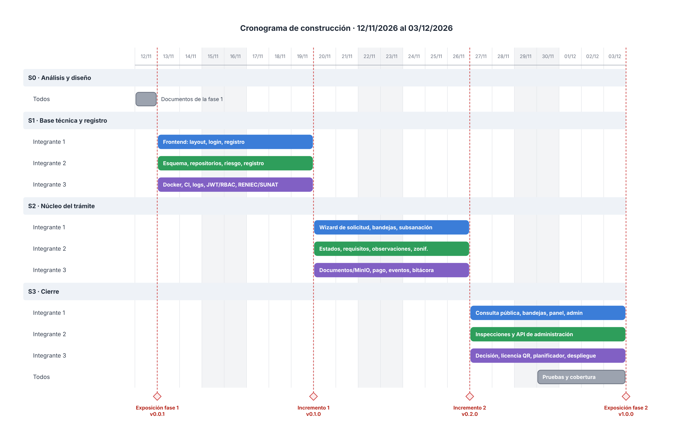

# 8. Plan de implementación

| Proyecto | Curso | Entrega | Versión | Fecha |
|---|---|---|---|---|
| SiMuLiF, Sistema Municipal de Licencias de Funcionamiento (proyecto 4) | SW505 Proceso de Construcción de Software I, 2026-2 | Fase 1 (avance) y fase 2 | 1.0 | 12/11/2026 |

**Equipo:** 3 integrantes · **Periodo:** 13/11/2026 al 03/12/2026 · **Enfoque:** construcción incremental con Scrum ligero, con el sistema siempre ejecutable

## 1. Roles del equipo

| Integrante | Rol | Documentos a cargo | Foco en la construcción |
|---|---|---|---|
| Luis Bustamante Rojas | Desarrollador full stack | 1, 2 y 3 | Pantallas del solicitante y del público, bandejas, pruebas de aceptación contra los RF |
| Jose Antonio Arredondo Tomairo | Desarrollador full stack | 4, 5 y 8 | Lógica del trámite (riesgo, requisitos, plazos, observaciones, inspección) y repositorios |
| Jeanpier Alexander Robles Fabian | Desarrollador full stack | 6, 7 y 9 | Base de datos, seguridad, integraciones simuladas, generación de PDF/QR, Docker y CI |

Los tres trabajan en frontend y backend; el foco solo indica quién lidera cada parte y revisa los cambios que la tocan.

> Cada integrante también escribe las **pruebas unitarias de su código**. Ninguno hace merge de su propio PR: lo revisa otro integrante.

## 2. Incrementos

*Figura: Cronograma (diagrama de Gantt).*

Cada incremento termina con: sistema levantando con `docker compose up`, CI en verde, demo funcional y **tag SemVer**.

| Incremento | Fechas | Objetivo | Tag |
|---|---|---|---|
| **S0** Análisis y diseño | hasta 12/11 | Documentos de la fase 1, repositorio, README | `v0.0.1` |
| **S1** Base técnica y registro | 13/11 al 19/11 | Esqueleto que corre de punta a punta + autenticación + registro de solicitante y establecimiento con cálculo de riesgo | `v0.1.0` |
| **S2** Núcleo del trámite | 20/11 al 26/11 | Solicitud, requisitos, documentos, pago, presentación, verificación, observaciones/subsanación, zonificación | `v0.2.0` |
| **S3** Cierre | 27/11 al 03/12 | Inspección, decisión, licencia PDF con QR, consulta pública, bandejas, plazos/abandono, panel, pruebas, documentación | `v1.0.0` |

### S1 (13/11 al 19/11): base técnica
| Tarea | Responsable | RF / CUS |
|---|---|---|
| Docker Compose (nginx, api, frontend, postgres, mongo, minio, mailhog), `.env.example`, Makefile | Jeanpier Robles | RNF-13 |
| Pipeline CI: ruff, mypy, pytest + cobertura, build del frontend | Jeanpier Robles | RNF-16 |
| Logging JSON + correlation-id + `/api/health` + `/api/metrics` | Jeanpier Robles | RNF-11 |
| Alembic con el esquema de `01_schema.sql` + carga de semilla | Jose Arredondo | 06 |
| Modelos SQLAlchemy y repositorios base; repositorio Mongo de eventos | Jose Arredondo | 04 |
| Autenticación JWT, bloqueo por intentos, RBAC | Jeanpier Robles | RF-T01, RF-T02 · CUS-01 |
| Adaptadores RENIEC/SUNAT simulados | Jeanpier Robles | RF-101, RF-102 |
| `CalculadoraRiesgo` + pruebas BVA de umbrales | Jose Arredondo | RF-204 |
| Casos de uso registrar solicitante, representante y establecimiento | Jose Arredondo | CUS-02, CUS-03 |
| Frontend: layout, login, registro, mis establecimientos | Luis Bustamante | CUS-01 a 03 |

### S2 (20/11 al 26/11): núcleo del trámite
| Tarea | Responsable | RF / CUS |
|---|---|---|
| `MaquinaEstadosExpediente` + `CalendarioHabil` + pruebas unitarias exhaustivas | Jose Arredondo | 05 §3 · RN-06 |
| `ResolutorRequisitos` (procedimiento × persona × riesgo × condición) | Jose Arredondo | RF-302 · RN-04 |
| Casos de uso crear solicitud, presentar, verificar requisitos | Jose Arredondo | CUS-04, CUS-07 |
| `ServicioDocumentos` (MinIO, SHA-256, URL firmada) + `GeneradorPDF` del cargo | Jeanpier Robles | CUS-05 · RF-303 |
| Pasarela de pago simulada | Jeanpier Robles | CUS-06 |
| Bus de eventos + bitácora + notificador simulado | Jeanpier Robles | RF-T03, RF-T04 |
| Observaciones y subsanación (Mongo) | Jose Arredondo | CUS-11, CUS-12 |
| Evaluación de zonificación + adaptador de tabla | Jose Arredondo | CUS-08 |
| Frontend: wizard de solicitud (requisitos, carga, pago, DJ), mis expedientes con línea de tiempo, bandeja de mesa de partes y evaluador, subsanación | Luis Bustamante | CUS-04 a 08, 11, 12, 15, 17 |
| Pruebas de integración API + repositorios (Testcontainers) | Luis Bustamante y Jeanpier Robles | 10 |

### S3 (27/11 al 03/12): cierre
| Tarea | Responsable | RF / CUS |
|---|---|---|
| Programar e inspeccionar (plantillas Mongo, fotos) | Jose Arredondo | CUS-09, CUS-10 |
| Decisión + emisión de licencia PDF con QR + resolución | Jeanpier Robles | CUS-13, CUS-14 |
| Planificador: abandono, alertas, silencio positivo | Jeanpier Robles | CUS-20 |
| Consulta pública y verificación de licencia | Luis Bustamante | CUS-16 |
| Bandejas de inspector y jefe; panel de indicadores; auditoría | Luis Bustamante | CUS-17, CUS-19 |
| Administración de catálogos y usuarios | Luis Bustamante + Jose Arredondo | CUS-18 |
| Completar pruebas, cobertura ≥ 70 % de ramas en negocio, reporte de resultados | Todos | 10 |
| Guía de despliegue probada en máquina limpia, documentación del código, video/demo | Jeanpier Robles | 09 |

## 3. Flujo de trabajo con Git
- **Ramas:** `main` (siempre desplegable) y `feature/<CUS o RF>-<descripcion>` (ej. `feature/CUS-04-presentar-solicitud`). Ramas cortas (≤ 3 días).
- **Commits:** Conventional Commits en español: `feat(solicitudes): presentar expediente con cálculo de fecha límite`, `test(riesgo): valores límite de área y aforo`, `fix(documentos): validar tipo real del archivo`.
- **Pull request:** plantilla con checklist de revisión (legibilidad, robustez, pruebas y seguridad); CI debe pasar; 1 aprobación de otro integrante; squash merge.
- **Tags:** `v0.1.0`, `v0.2.0`, `v1.0.0` al cierre de cada incremento.
- **Regla del equipo:** si el CI de `main` está en rojo, se arregla antes de seguir.

## 4. Definición de terminado (DoD)
Una historia o caso de uso está terminado cuando:
1. Cumple sus criterios de aceptación (RF).
2. Tiene pruebas unitarias (AAA, casos felices, negativos y límites) y, si toca BD o API, prueba de integración.
3. Pasa lint, tipos y cobertura en CI.
4. Fue revisado y aprobado en PR por otro integrante.
5. Está documentado (docstrings y OpenAPI) y registra eventos/auditoría si corresponde.

## 5. Ceremonias (ligeras)
- **Planificación** al inicio de cada incremento (30 min).
- **Daily** asíncrona por chat: qué hice, qué haré, bloqueos.
- **Revisión + retro** al final (demo de 15 min y 3 mejoras).
- Tablero en **GitHub Projects** con columnas Backlog / En curso / En revisión / Hecho; cada tarjeta enlaza su RF o CUS.

## 6. Riesgos

| Riesgo | Prob. | Impacto | Mitigación |
|---|---|---|---|
| Alcance excesivo para 3 semanas | Alta | Alto | Priorizar los RF "M"; los "S" y "C" solo si sobra tiempo |
| Integración tardía entre frontend y backend | Media | Alto | Contrato OpenAPI desde S1; integrar en cada PR (nada de Big Bang) |
| Poca experiencia con MongoDB/MinIO | Media | Medio | Repositorios y servicio documental en S1/S2 con pruebas de integración temprano |
| Equipos sin Docker o con poca RAM | Media | Medio | Perfil "ligero" sin MailHog; documentar requisitos mínimos |
| Ambigüedad normativa (plazos/requisitos) | Media | Bajo | Todo parametrizado (RNF-15); valores semilla marcados como referenciales |
| Ausencia de un integrante | Baja | Alto | PRs pequeños, conocimiento compartido por revisión cruzada, documentación al día |
