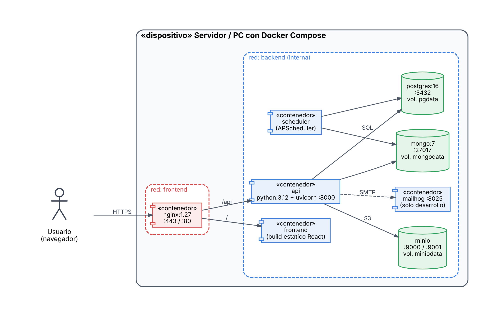

# 9. Guía de despliegue y operaciones

| Proyecto | Curso | Entrega | Versión | Fecha |
|---|---|---|---|---|
| SiMuLiF, Sistema Municipal de Licencias de Funcionamiento (proyecto 4) | SW505 Proceso de Construcción de Software I, 2026-2 | Fase 1 (avance) y fase 2 | 1.0 | 12/11/2026 |

> Versión de diseño. La guía se actualizará con el sistema construido y se validará en una máquina limpia antes del 03/12/2026.

## 1. Entornos



*Figura: Diagrama de despliegue.*

| Entorno | Dónde | Cómo |
|---|---|---|
| Desarrollo | PC de cada integrante | `docker compose --profile dev up` (incluye MailHog) o backend con `uvicorn --reload` contra las BD en contenedores |
| Pruebas (CI) | GitHub Actions | Pipeline `ci.yml`; Testcontainers levanta PostgreSQL, MongoDB y MinIO por prueba |
| Producción simulada | Un servidor o PC con Docker | `docker compose up -d` sin perfil `dev`; solo Nginx expone puertos |

## 2. Requisitos
- Docker Engine 24+ y Docker Compose v2 (Docker Desktop en Windows/macOS).
- 4 GB de RAM libres y 5 GB de disco.
- Puertos libres: 80 y 443 (y 8025, 9001 en desarrollo).
- Git y OpenSSL (para el certificado autofirmado).

## 3. Despliegue paso a paso

```bash
# 1. Clonar el repositorio
git clone https://github.com/jeannrf/proy_sw505-2026_2_grp_2.git && cd proy_sw505-2026_2_grp_2

# 2. Configurar variables de entorno
cp deploy/.env.example deploy/.env
#    Editar deploy/.env: contraseñas de PostgreSQL, MongoDB y MinIO, y JWT_SECRET
python -c "import secrets; print(secrets.token_urlsafe(48))"   # para JWT_SECRET

# 3. Generar certificado TLS autofirmado (solo la primera vez)
make certs

# 4. Construir y levantar
make up            # equivale a: cd deploy && docker compose up -d --build

# 5. Verificar
cd deploy && docker compose ps          # todos "healthy" o "running"
curl -k https://localhost/api/health    # {"status":"ok", "postgres":"ok", "mongo":"ok", "minio":"ok"}
```

Abrir `https://localhost` (aceptar el certificado autofirmado). Usuarios de prueba: ver [modelo físico §1.4](<../analisis_y_diseño/6. Modelo físico de datos.md>).

**Qué ocurre en el primer arranque:**
1. PostgreSQL ejecuta `database/sql/01_schema.sql` y `02_seed.sql` (esquema, catálogos, usuarios de prueba).
2. MongoDB ejecuta `database/mongo/01_init.js` (colecciones, validadores, índices, plantillas de inspección).
3. `minio-init` crea los buckets privados `expedientes`, `inspecciones` y `emitidos`.
4. `api` arranca cuando las tres dependencias están sanas; `scheduler` arranca cuando `api` está sano.

> Los scripts de inicialización solo corren con volúmenes **vacíos**. Para reiniciar desde cero: `docker compose down -v` (**borra todos los datos**).

## 4. Variables de entorno principales

| Variable | Descripción |
|---|---|
| `POSTGRES_DB`, `POSTGRES_USER`, `POSTGRES_PASSWORD` | Base relacional |
| `MONGO_USER`, `MONGO_PASSWORD` | Base documental |
| `MINIO_ROOT_USER`, `MINIO_ROOT_PASSWORD` | Almacenamiento de objetos (contraseña ≥ 8 caracteres) |
| `JWT_SECRET`, `JWT_ACCESS_MINUTES`, `JWT_REFRESH_HOURS` | Tokens |
| `APP_BASE_URL` | URL pública (se usa en el QR de la licencia) |
| `CORS_ORIGINS` | Orígenes permitidos |
| `NOTIFICACIONES_SMTP_HABILITADO` | `true` para enviar los correos simulados a MailHog |
| `LOG_LEVEL` | `INFO` en producción, `DEBUG` en desarrollo |

## 5. Operación diaria

| Tarea | Comando / acción |
|---|---|
| Ver estado | `docker compose ps` |
| Ver logs del API (JSON) | `make logs` o `docker compose logs -f api` |
| Filtrar una petición | `docker compose logs api \| grep <correlation_id>` |
| Métricas | `docker compose exec api curl -s localhost:8000/api/metrics` (bloqueado desde fuera por Nginx) |
| Consola de MinIO (desarrollo) | `http://localhost:9001` |
| Correos simulados (desarrollo) | `http://localhost:8025` |
| Tareas programadas | El servicio `scheduler` corre a las 00:30 el control de plazos y abandono (CUS-20); logs con `docker compose logs scheduler` |

## 6. Respaldo y recuperación
- **Respaldo diario** (`make backup` o cron con `deploy/scripts/backup.sh`): `pg_dump -Fc`, `mongodump --archive` y `mc mirror` de los buckets en `deploy/backups/AAAAMMDD_HHMM/`. Conservar 7 días. **RPO: 24 h.**
- **Restauración (RTO objetivo: 4 h):**
```bash
docker compose exec -T postgres pg_restore -U $POSTGRES_USER -d $POSTGRES_DB --clean < backups/<fecha>/simulif.dump
docker compose exec -T mongo mongorestore --archive --drop --username $MONGO_USER --password $MONGO_PASSWORD --authenticationDatabase admin < backups/<fecha>/licencias_nosql.archive
# Archivos: mc mirror backups/<fecha>/minio local/  (desde el contenedor minio-init)
docker compose restart api scheduler
```

## 7. Actualización de versión
```bash
git fetch --tags && git checkout v1.0.0
make backup
cd deploy && docker compose up -d --build
docker compose exec api alembic upgrade head     # migraciones versionadas
curl -k https://localhost/api/health
```
**Rollback:** `git checkout <tag anterior>`, `docker compose up -d --build` y, si la migración no es reversible, restaurar el respaldo.

## 8. Seguridad operativa
- No versionar `deploy/.env` ni certificados (`.gitignore`).
- Cambiar las contraseñas de los usuarios de prueba fuera del entorno académico.
- Rotar `JWT_SECRET` (invalida las sesiones) y las credenciales de BD cada semestre.
- Solo Nginx expone puertos; las BD quedan en la red interna.
- Revisar dependencias con `pip-audit` y `npm audit` antes de cada versión.

## 9. Solución de problemas

| Síntoma | Causa probable | Solución |
|---|---|---|
| `api` en estado *unhealthy* | BD no lista o `.env` incorrecto | `docker compose logs api`; revisar credenciales |
| Los scripts de BD no se ejecutaron | El volumen ya existía | `docker compose down -v` y volver a levantar (borra datos) |
| Error 413 al subir archivos | Archivo > 12 MB | Límite: 10 MB por archivo (RNF/RN-11) |
| El navegador rechaza HTTPS | Certificado autofirmado | Aceptar la excepción o instalar el certificado local |
| Puerto 80/443 ocupado | Otro servidor web | Detenerlo o cambiar los puertos en `docker-compose.yml` |
